# AI Agent 사용 설명서

AI Agent 는 회사 서버에서 도는 AI 작업 도우미입니다. 대화창에 일을 적으면 AI 가 파일을 읽고 만들고, 명령을 실행하고,
회사가 정리해 둔 자료(사용설명서 · 에러 대처 등)를 찾아 답합니다. 파일을 고치거나 명령을 실행하기 전에는 **반드시 사람에게 승인을 받습니다.**

- **일반 사용자**는 [2장](#2-화면-구성) · [3장](#3-일-시키기-대화-화면) · [5장](#5-작업-폴더--코드) · [6장](#6-파일-탐색기) · [10장](#10-내-계정)을 보면 됩니다.
- **관리자**는 전부 봅니다. 관리자만 보이는 메뉴(상태 · 연결, 설정 · 프롬프트, 관리)와 기능(CLI, 작업 위치)에는 `관리자` 라고 적었습니다.
- 캡처는 시험용 데이터로 찍었습니다. 화면의 폴더 경로 · 계정 · 주소는 실제와 다르고, 일부 주소는 예시 값으로 바꿨습니다.

## 목차

1. [시작하기](#1-시작하기)
2. [화면 구성](#2-화면-구성)
3. [일 시키기 (대화 화면)](#3-일-시키기-대화-화면)
4. [CLI 로 일 시키기 — Claude Code · Codex · Gemini](#4-cli-로-일-시키기--claude-code--codex--gemini-관리자) `관리자`
5. [작업 폴더 · 코드](#5-작업-폴더--코드)
6. [파일 탐색기](#6-파일-탐색기)
7. [상태 · 연결](#7-상태--연결-관리자) `관리자`
8. [하네스 · 설정 · 프롬프트 — 지침 · 자료 · 용도 · 워크플로](#8-하네스--설정--프롬프트-관리자) `관리자` ← **가장 중요**
9. [관리 — 사용자 · 외부 AI 모델 · 기록 · 접속](#9-관리-관리자) `관리자`
10. [내 계정](#10-내-계정)
11. [문제가 생겼을 때](#11-문제가-생겼을-때)

---

## 1. 시작하기

### 1.1 서버 켜기 · 접속하기

- 서버 PC 에서 프로젝트 폴더의 **`start.cmd`** 를 두 번 누르면 관리 서버와 모델 서버가 함께 켜지고 브라우저가 열립니다.
  이미 켜져 있으면 다시 켜지 않고 화면만 엽니다.
- 접속 주소: 서버 PC 에서는 `http://127.0.0.1:8765`, 다른 PC 에서는 관리자가 [접속 설정](#95-접속-설정)에 넣은 주소(예: `http://192.168.0.10:8765`).

### 1.2 첫 관리자 만들기

처음 설치한 서버에 들어가면 **첫 관리자 만들기** 화면이 뜹니다. 아이디 · 이름 · 비밀번호(8자 이상)를 넣고 **관리자 만들고 시작하기** 를 누르면
그 계정으로 바로 로그인됩니다. 다른 사람이 먼저 가로채지 못하게 **서버 PC 에서만** 만들 수 있습니다.

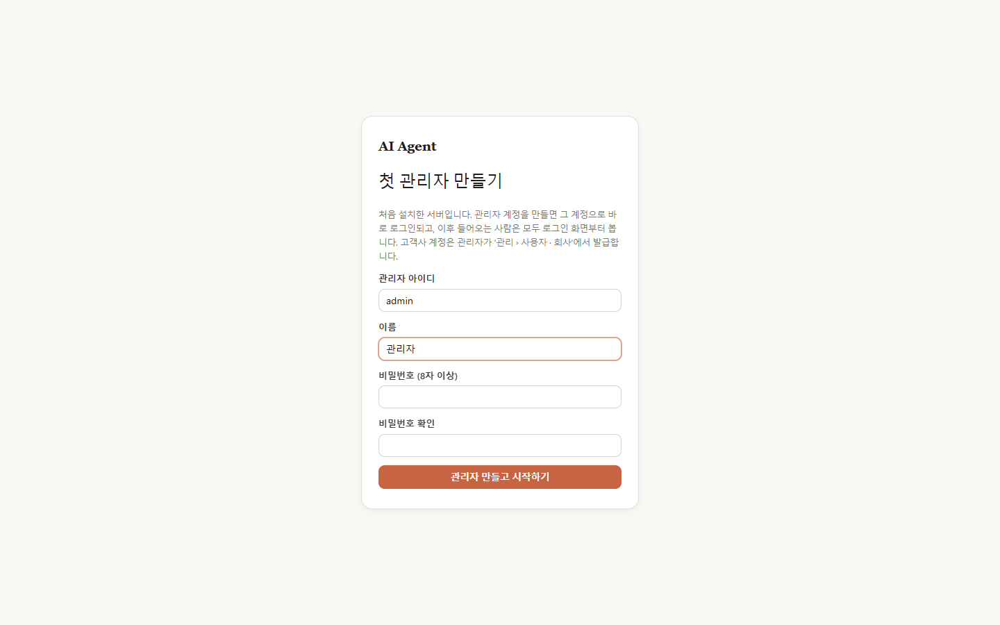

### 1.3 로그인

그 뒤로는 누구든 로그인 화면부터 봅니다. 계정은 관리자가 발급합니다 ([9.1 사용자 · 회사](#91-사용자--회사)).

- 처음 로그인하면 관리자에게 받은 **임시 비밀번호**를 새 비밀번호로 바꾸라고 나옵니다.
- 비밀번호를 잊었으면 **비밀번호를 잊었어요** → 관리자 화면에 요청이 뜨고, 관리자가 임시 비밀번호를 만들어 직접 전해 줍니다 (메일은 보내지 않습니다).

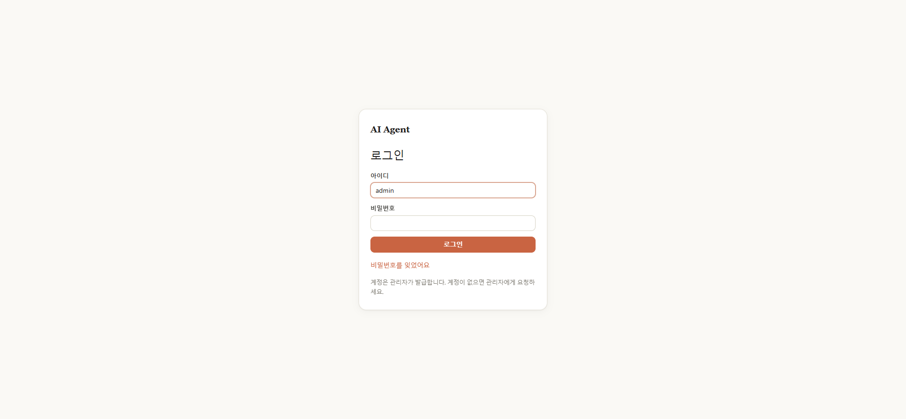

---

## 2. 화면 구성

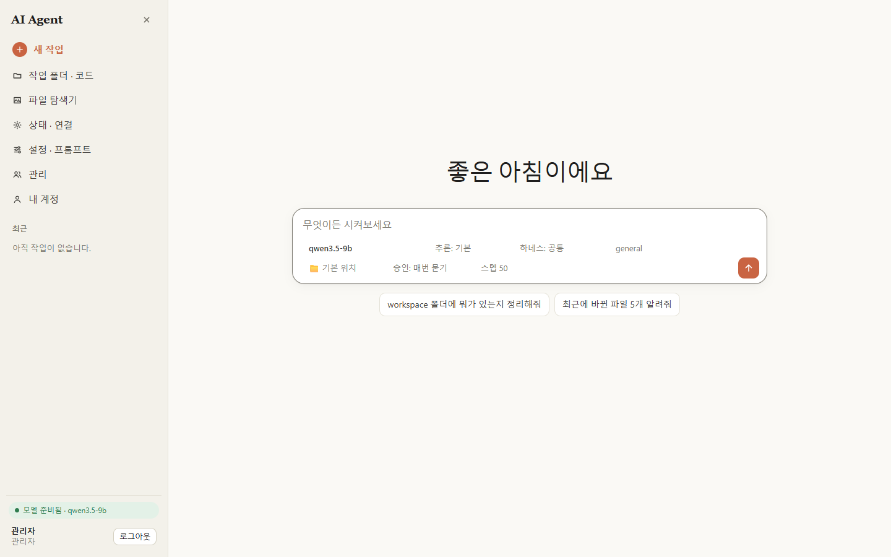

왼쪽 사이드바:

| 메뉴 | 하는 일 |
|---|---|
| **새 작업** | 새 대화를 시작합니다. |
| **작업 폴더 · 코드** | AI 가 대화마다 만든 작업 폴더와 파일을 봅니다 ([5장](#5-작업-폴더--코드)). |
| **파일 탐색기** | 작업 폴더와 허용된 공유 폴더의 파일을 봅니다 ([6장](#6-파일-탐색기)). |
| **상태 · 연결** `관리자` | 모델 서버 · GPU · 작업 폴더 · 사내 시스템 연결 상태 ([7장](#7-상태--연결-관리자)). |
| **설정 · 프롬프트** `관리자` | 하네스 · 용도 · 워크플로 · 공통 설정 ([8장](#8-하네스--설정--프롬프트-관리자)). |
| **관리** `관리자` | 사용자 · 회사, 외부 AI 모델, 기록 · 사용량, 접속 설정 ([9장](#9-관리-관리자)). |
| **내 계정** | 비밀번호 바꾸기, 내 사내 API 계정 ([10장](#10-내-계정)). |
| **최근** | 지난 대화 목록. 누르면 그 대화로 돌아갑니다. `CLI` 가 붙은 것은 CLI 대화입니다. 점(●)은 확인이 필요한 대화입니다. |

사이드바 맨 아래 상태 표시(예: `● 모델 준비됨 · qwen3.5-9b`)가 초록색이면 바로 일을 시킬 수 있습니다.

---

## 3. 일 시키기 (대화 화면)

### 3.1 입력창에서 고르는 것

입력창에 할 일을 적고 **Enter**(줄바꿈은 Shift+Enter) 또는 보내기 버튼을 누릅니다. 입력창 아래에서 다음을 고릅니다 (왼쪽부터 차례로).

| 항목 | 설명 |
|---|---|
| **모델** | **로컬**(이 서버의 GPU · 인터넷 없이) · **☁ 외부 모델**(OpenAI · Claude · Gemini API — 관리자가 연결한 것) · **⌘ CLI**(`관리자` [4장](#4-cli-로-일-시키기--claude-code--codex--gemini-관리자)). |
| **추론** | 기본 · 낮음 · 보통 · 높음 … 높을수록 더 오래 생각해 꼼꼼하지만 느립니다. 로컬 모델은 낮음 = 빠르게, 높음 = 생각을 켜고 꼼꼼히. |
| **하네스** | 공통 하네스에 더해 붙일 회사 · 프로젝트 하네스(지침 · 용도 · 자료 묶음). 회사 하네스는 그 회사 사람에게는 고르지 않아도 붙습니다. |
| **용도** | 어떤 역할로 일할지 — 예: `general`(일반), `coder`(개발 · 실행), `support`(장비 문의). 고른 하네스의 용도가 위쪽에 더해집니다. `⛓` 로 시작하는 것은 워크플로(여러 단계를 차례로 실행)입니다. |
| **위치** `관리자` | 새 작업 폴더를 만들 곳 (기본 위치 = 작업 폴더). 대화마다 `날짜_시각_요청` 폴더를 만들어 그 안에서 일합니다. |
| **승인** | **매번 묻기**(권장) · **파일 쓰기 자동** · **전부 자동**. 전부 자동은 명령 실행까지 묻지 않으니 믿을 수 있는 일에만 씁니다. |
| **스텝** | AI 가 도구를 몇 번까지 쓸지 (20 · 50 · 100 · 무제한). |

**'/' 명령** — 입력창 맨 앞에 `/` 를 치면 명령 목록이 뜹니다. 글자를 더 치면 좁혀지고(한국어 이름도 됨 — `/용도`, `/사용량`), ↑↓ 로 고르고 **Enter** 로 실행,
**Tab** 은 이름만 채우기, **Esc** 는 닫기입니다. 값을 고르는 명령(`/model` `/role` …)은 Enter 를 누르면 고를 값이 이어서 나옵니다.

| 묶음 | 명령 |
|---|---|
| **이 화면** | `/new` 새 대화 · `/model` 모델 · `/effort` 추론 · `/harness` 하네스 · `/role` 용도 · `/workflow` 워크플로 · `/approve` 승인 · `/steps` 스텝 · `/usage` 이 대화의 사용량(요청 · 스텝 · 토큰 · 시간) · `/context` 대화가 모델 한도에서 얼마나 찼는지 · `/retry` 마지막 요청 다시 · `/stop` 중지 |
| **하네스 명령** | 관리자가 하네스에 만든 명령 ([8.4](#84-하네스-파일-쓰는-법) '명령'). 예: `/에러조치 E-104` → 정해 둔 요청으로 펼쳐서 보냅니다. |
| **기본 요청** | `/init` 이 작업 폴더를 살펴 폴더 지침(AGENT.md)을 만들기 · `/review` 만든 · 바꾼 것을 검토해 문제 목록으로 (고치지 않음) |

CLI 대화([4장](#4-cli-로-일-시키기--claude-code--codex--gemini-관리자))에서는 여기에 `/mode` 승인 방식 · `/rename` 대화 이름 · `/instructions` 지침 보기 · `/attach` 첨부와,
**그 CLI 가 알려 준 명령**(Claude Code 의 `/compact` `/context` `/usage` `/init` `/code-review` · 스킬 · 사용자 명령, Gemini 의 명령)이 더해집니다 — 고르면 그대로 CLI 가 실행합니다.
Codex 는 명령 목록을 주지 않아 `/init`(AGENTS.md) · `/review` 기본 요청을 씁니다.

### 3.2 승인하기

AI 가 파일을 만들거나 고치거나, 명령을 실행하려 하면 노란 **승인이 필요합니다** 상자가 뜹니다. 무엇을 하려는지(파일 이름 · 내용 · 명령)를 확인하고 고릅니다.

- **승인**: 이번 한 번 허용합니다.
- **거부**: 하지 않게 합니다. AI 는 다른 방법을 찾거나 이유를 알려 줍니다.
- **이번 실행은 모두 승인**: 이 요청이 끝날 때까지는 다시 묻지 않습니다.

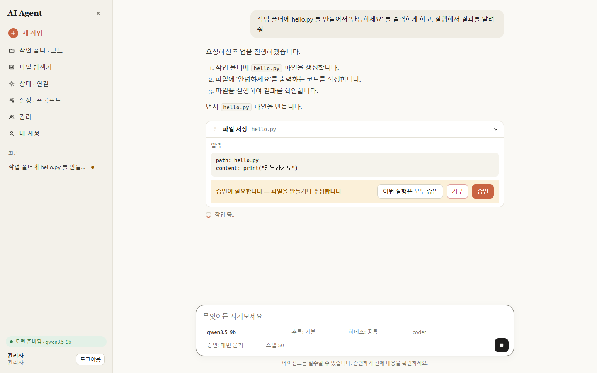

### 3.3 진행 상황 보기

AI 가 쓴 도구는 회색 카드로 쌓입니다 (`파일 저장 hello.py` · `명령 실행 python hello.py` 등). 카드를 누르면 입력과 결과가 펼쳐집니다.
`↺ … 되돌려 보냄` 은 프로그램이 결과를 점검해 빠진 것을 다시 하게 한 표시입니다 (예: `coder` 용도는 개발 규격 — 프로젝트 폴더 · 시험 · 실행 확인 — 을 지키게 합니다).

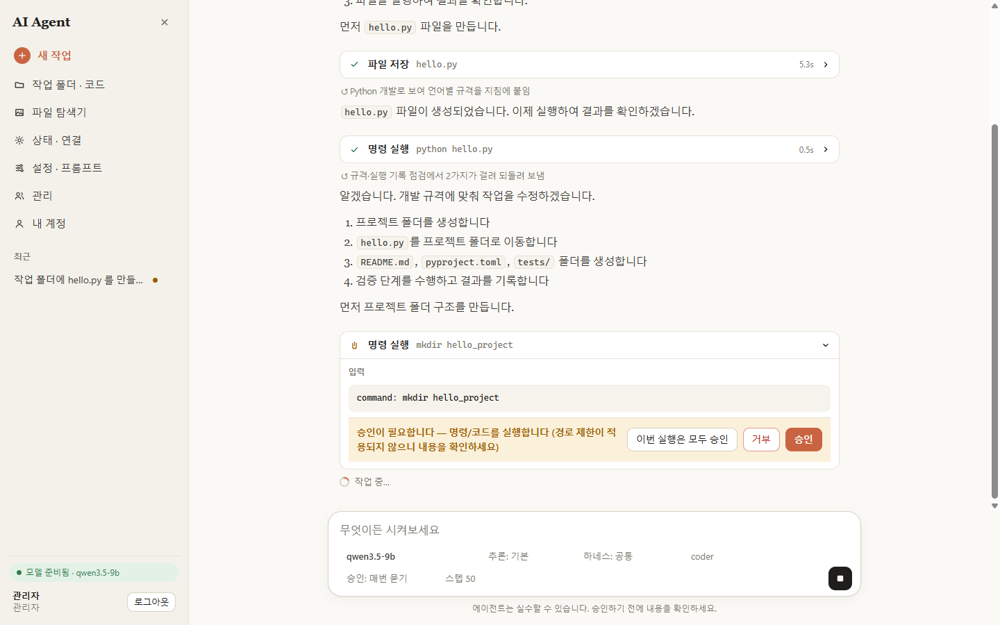

### 3.4 결과

끝나면 답과 함께 아래 줄에 **복사** · 작업 폴더(누르면 그 폴더를 엽니다) · **코드 보기** · 쓴 스텝 · 토큰 · 걸린 시간이 나옵니다.
아래 예는 `support` 용도가 하네스 자료(`장비-X100/E-104 노즐 과열.md`)를 찾아 읽고 답한 것입니다 — 자료에 없는 내용은 지어내지 않습니다.

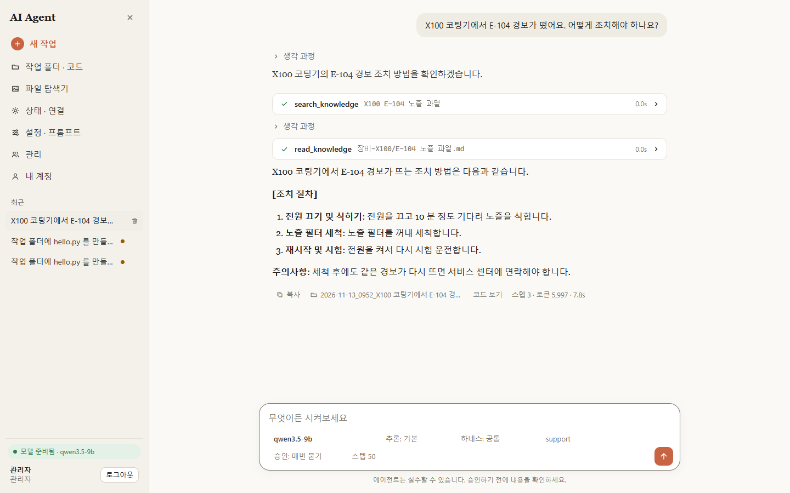

- **이어서 하기**: 같은 대화의 입력창에 이어서 적으면 앞의 내용과 같은 작업 폴더를 그대로 이어받습니다.
- **생각 과정**: 접힌 `생각 과정` 을 누르면 AI 가 어떻게 판단했는지 볼 수 있습니다.

### 3.5 작업이 멈췄을 때

같은 시도를 되풀이하거나, 답이 기록과 맞지 않으면 프로그램이 멈추고 이유를 적습니다 (`실행 기록 점검`).
노란 줄의 안내대로 **힌트를 적어 보내거나** **계속하기** 를 누르면 이어서 합니다. 어려운 개발 작업은 더 큰 모델이나 외부 모델이 잘 합니다.

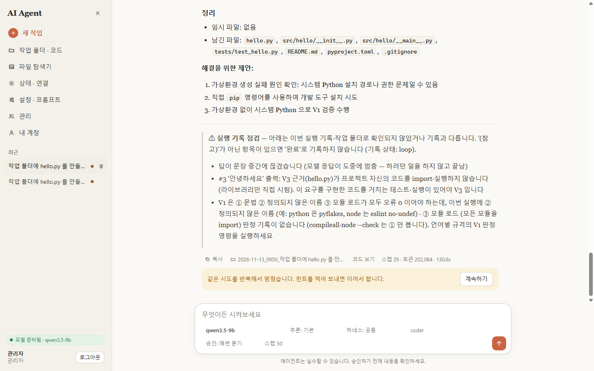

---

## 4. CLI 로 일 시키기 — Claude Code · Codex · Gemini `관리자`

이 서버 PC 에 설치 · 로그인된 **Claude Code**(Anthropic) · **Codex**(OpenAI) · **Gemini CLI**(Google)를 같은 대화 화면에서 씁니다.
모델 선택의 **CLI** 묶음에서 `⌘ Claude Code · …` / `⌘ Codex · …` / `⌘ Gemini · …` 를 고르고 보내면 됩니다.

- **같은 지침**: 로컬 · API 모델과 같은 하네스 · 용도 지침이 CLI 에도 붙습니다. 입력창의 **지침** 버튼으로 무엇이 붙는지 볼 수 있습니다.
  하네스 · 용도는 대화의 첫 요청 때 정해지고, 그 대화 동안 바뀌지 않습니다.
- **승인 방식**: 매번 묻기 · 편집 자동(파일 수정만 자동) · 계획(실행 · 수정 없이 읽고 계획만).
- 위쪽 줄에 작업 폴더 · CLI 상태(pid) · 모델이 보이고, **프로세스 닫기** 로 CLI 를 닫을 수 있습니다 (대화 기록은 남고, 다시 보내면 이어서 합니다).
- 쓸 수 없으면 입력창 위에 까닭(설치 필요 · 로그인 필요 · 폐쇄망 스위치)이 나옵니다 → [9.3 CLI 연결](#93-외부-ai-모델--cli).

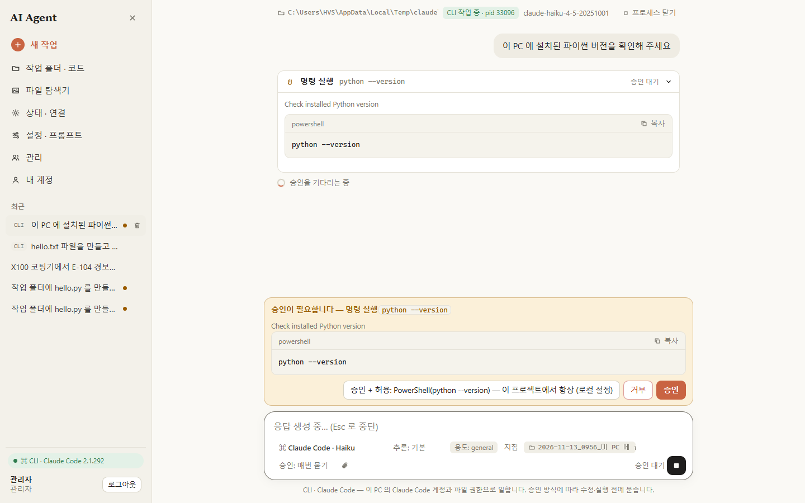

승인 상자의 버튼:

- **승인** / **거부**: 거부를 누르면 **거부 사유** 칸이 열립니다. 적어 보내면 CLI 가 그것을 보고 다시 합니다 (예: "현재 폴더에 만들어 주세요").
- **거부하고 중단**: 응답을 멈춥니다.
- **승인 + … 이 세션 동안**(Claude Code): 이 대화 동안 같은 종류를 다시 묻지 않습니다.
- 경로가 맞는지 꼭 보고 승인하세요. AI 가 엉뚱한 폴더에 쓰려 하면 `Path is outside allowed working directories` 같은 경고가 함께 나옵니다.

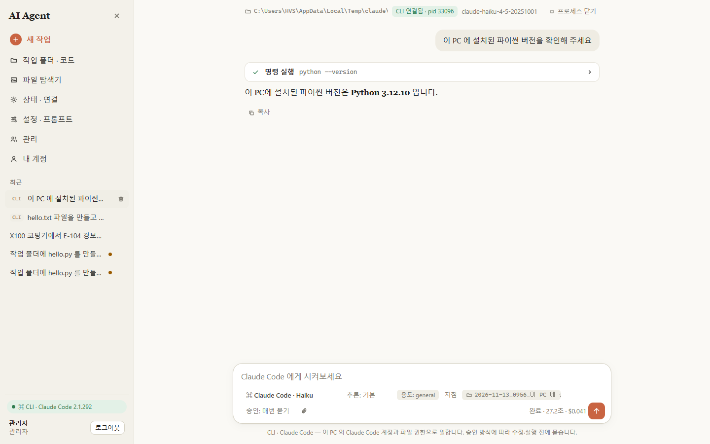

---

## 5. 작업 폴더 · 코드

AI 가 대화마다 만든 작업 폴더를 봅니다. 가운데에서 폴더 · 파일을 고르면 오른쪽에 내용이 나옵니다 (마크다운은 보기 좋게, `원문` 으로 그대로).
각 폴더의 **`작업기록.md`** 에는 요청 · 한 일(도구 사용 내역) · 결과가 실행마다 자동으로 쌓입니다. 로그인 사용 중에는 각자 자기 폴더(`users/<아이디>`)만 보이고, 관리자는 전부 봅니다.

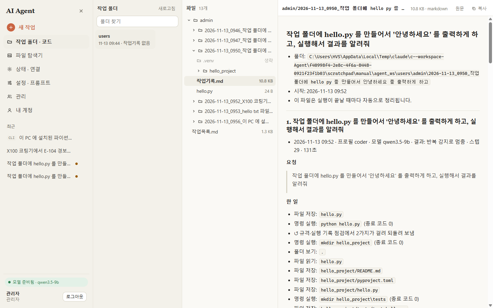

---

## 6. 파일 탐색기

작업 폴더와 **허용한 공유 위치**(예: `\\서버\공유\폴더`, `Z:\폴더`)의 파일을 봅니다. 폴더를 고른 뒤 **이 폴더로 작업 시키기** 를 누르면
새 작업 입력창에 그 경로가 채워집니다. 공유 위치는 채팅에 경로를 주면 처음 한 번 허용을 묻고, 아래 칸에서 직접 더할 수도 있습니다.

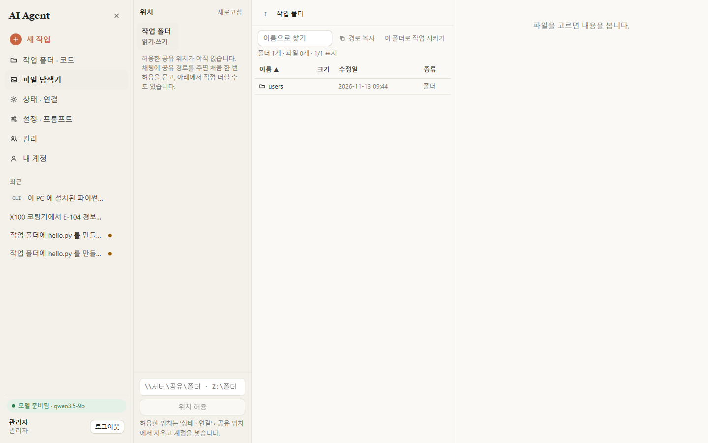

---

## 7. 상태 · 연결 `관리자`

모델 서버(준비됨 · 주소 · 모델 파일 · 컨텍스트), 받아 둔 모델 목록(**이 모델 쓰기** 로 바꾸기 — 다시 불러오는 데 수십 초),
GPU 사용량, 작업 폴더와 권한, 한도(최대 스텝 · 실행 시간), 사내 시스템 · 공유 위치 연결을 한눈에 봅니다.

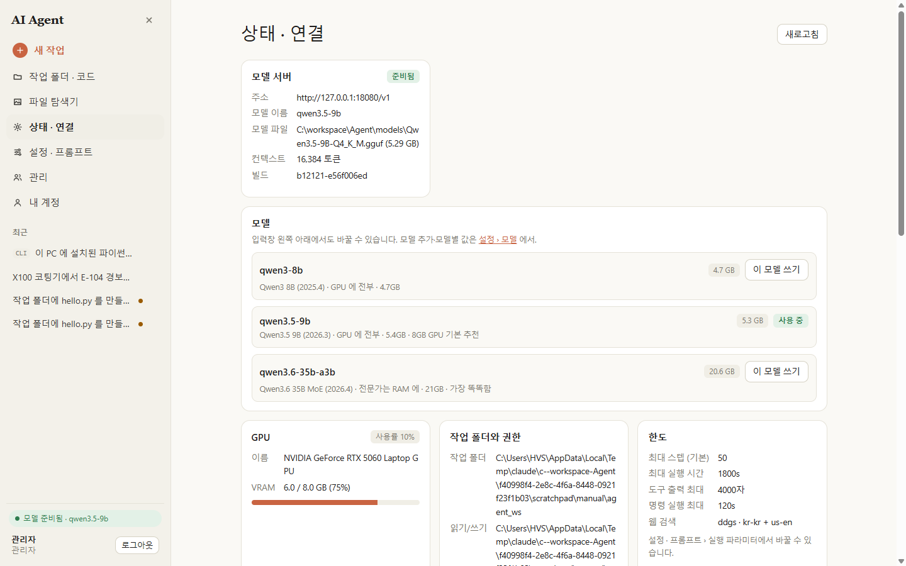

---

## 8. 하네스 · 설정 · 프롬프트 `관리자`

이 장이 가장 중요합니다. AI 가 **무엇을 알고(자료), 어떤 규칙으로(지침), 어떤 역할로(용도), 어떤 순서로(워크플로)** 일할지를 여기서 정합니다.
모델이 로컬이든 외부 API 든 CLI 든 **같은 설정이 똑같이 적용**됩니다. 저장하면 **다음 실행부터** 반영됩니다 (진행 중인 대화에는 영향 없음).

### 8.1 무엇을 어디서 정하나

| 정할 것 | 어디서 | 저장 위치 | 언제 쓰나 |
|---|---|---|---|
| 회사 규칙 · 응대 원칙 | 하네스 › **지침**(`AGENT.md`) | `harness\AGENT.md` | 모든 실행에 붙일 규칙 (말투, 금지 사항, 보고 방식) |
| 자료 (설명서 · 에러 대처 · 절차) | 하네스 › **자료 폴더** | `harness\<폴더>\*.md` | AI 가 찾아 읽고 답할 근거 |
| 역할 | 하네스 › **용도**(`agents\*.md`) 또는 **용도** 탭 | `harness\agents\` 또는 `config\agents\*.yaml` | "장비 문의 담당", "시험 담당" 같은 역할별 지시 · 도구 |
| 회사 · 프로젝트 전용 묶음 | **＋ 새 하네스** | `harnesses\<이름>\` | 특정 회사 · 프로젝트에만 쓸 지침 · 용도 · 자료 |
| AI 의 일하는 방식 (공통 문단) | 공통 › **공통 블록** | `config\prompts.yaml` | 작업 방식 · 실행 환경 · 개발 규격 요약 같은 문단 |
| 여러 곳에 쓰는 값 | 공통 › **변수** | `config\prompts.yaml` | 회사 이름, 답변 언어 등 `{{이름}}` 으로 쓰는 값 |
| 정해진 순서의 작업 | **워크플로** | `config\workflows\*.yaml` | 조사 → 작성 → 검토 처럼 단계를 나눠 시킬 때 |
| 모델 · 생성 값 · 한도 | 공통 › **모델 · 실행 파라미터** | `config\settings.yaml` | 온도, 최대 스텝, 명령 시간 제한 등 |

> 원칙: **회사가 정하는 내용(규칙 · 자료 · 역할)은 하네스에**, **프로그램이 일하는 방식(블록 · 메시지 · 파라미터)은 공통 탭에** 둡니다.
> 하네스는 마크다운 파일이라 사람이 읽고 고치기 쉽고, 폴더째 복사해 다른 서버로 옮길 수 있습니다.

### 8.2 AI 에게 실제로 들어가는 지침 — 조립 순서

일을 시킬 때마다 아래 순서로 시스템 지침(시스템 프롬프트)을 새로 만듭니다. 내용이 빈 조각은 빠집니다.

```text
1. 역할            고른 용도의 역할 프롬프트 ({{변수}} 를 채워서)
2. 공통 지침       하네스 지침: 공통 AGENT.md → 보이는 폴더의 AGENT.md → 회사 하네스 지침 → 고른 하네스 지침
3. 작업 폴더 지침  대화 폴더(와 위 폴더)에 있는 AGENT.md · AGENTS.md · CLAUDE.md · GEMINI.md (폴더마다 하나)
4. 하네스 자료     자료 목록(경로 · 제목 · 설명)과 "기억으로 답하지 말고 찾아 읽은 뒤 답하라"는 안내 — 본문은 넣지 않음
5. 공통 블록       용도의 '프롬프트 구성' 순서대로 (작업 방식 → 개발 규격 요약 → 사내 연결 현황 → 실행 환경 → 언어별 규격 …)
6. 사용자가 준 지시 사용자가 지시 파일을 줬거나 "조회만" 같은 금지를 말했을 때
```

- **자료 본문은 지침에 넣지 않습니다.** 목록만 보여 주고, AI 가 `search_knowledge`(찾기) · `read_knowledge`(읽기) 도구로 필요한 부분만 꺼내 읽습니다.
  자료가 하나라도 있으면 이 두 도구는 **어느 용도든 저절로 붙고**, 용도의 도구 개수(최대 10개)에 들어가지 않습니다.
- **길이 한도:** 모델 컨텍스트가 32K 이하이면 지침 · 작업 폴더 지침은 각각 2,500자, 자료 목록은 30개까지만 붙습니다 (더 크면 12,000자 · 150개).
  넘으면 뒷부분을 자르고 "…(하네스 지침이 길어 뒷부분을 줄였습니다 — 관리자가 줄여야 합니다)" 라고 적힙니다. 지침은 **짧고 구체적으로** 쓰세요.
- **자동 블록:** `사내 연결 현황` 은 사내 도구가 있는 용도에만, `언어별 규격` 은 '개발 규격 적용' 용도가 Python · C# · Node 등으로 개발하는 것을 알아챘을 때만 채워집니다.
- **CLI(Claude Code · Codex · Gemini)** 에는 같은 순서로 조립하되 '실행 환경 · 사내 연결 현황 · 언어별 규격' 은 빼고 (CLI 가 자기 환경 정보를 가짐),
  자료는 "그 폴더에서 찾아 읽어라" + 폴더 실제 경로로 바꿔 붙입니다. CLI 는 **대화 첫 요청 때 지침을 고정**하므로, 지침을 고치면 새 대화부터 적용됩니다.
- 실제로 무엇이 붙는지는 **용도 › 미리보기**([8.8](#88-미리보기로-점검하기))와 CLI 입력창의 **지침** 버튼([8.6](#86-입력창--cli-에서-하네스-고르기))으로 확인합니다.

### 8.3 하네스가 여러 개일 때 — 무엇이 붙고 무엇이 우선하나

하네스는 **공통**(`harness\`) 하나와 **회사 · 프로젝트 하네스**(`harnesses\<이름>\`) 여러 개로 나뉩니다. 안의 모양(지침 · 용도 · 자료)은 모두 같습니다.

**붙는 순서** (뒤에 붙을수록 그 일에 가까운 지침):

1. **공통** — 늘 붙습니다.
2. **회사 하네스** — 일을 시킨 사람의 회사가 그 하네스의 '대상 회사' 에 있으면 **고르지 않아도** 붙습니다. (관리자에게는 저절로 붙지 않습니다 — 관리자는 직접 고릅니다.)
3. **고른 하네스** — 입력창의 **하네스** 선택이나 워크플로 노드에서 고른 것.

**용도 이름이 겹치면** 고른 하네스 → 회사 하네스 → 공통 하네스 → 용도 탭(yaml) 순서로 먼저 찾은 것을 씁니다.
예: 공통에도 `support`, 'ACME 회사' 하네스에도 `support` 가 있으면 ACME 사람은 ACME 의 `support` 로 일합니다.

**누가 무엇을 보나** (자료 · 폴더 지침):

| | 대상 회사가 빈 폴더 | 대상이 ACME 인 폴더 | 대상이 B사 인 폴더 |
|---|---|---|---|
| 관리자 · 혼자 쓰기 | ✔ | ✔ | ✔ |
| ACME 사용자 | ✔ | ✔ | — |
| 회사 없는 사용자 | ✔ | — | — |

- 폴더의 대상 회사는 **아래 폴더도 물려받습니다** (아래 폴더에서 따로 정하면 그것을 따름).
- 볼 수 있는 폴더의 **폴더 지침(`<폴더>\AGENT.md`)은 늘 지침에 붙습니다** — 그 폴더 자료를 쓸 때만이 아닙니다. 그래서 폴더 지침은 짧게, 그 자료에 대한 것만 씁니다.
- 다른 하네스의 자료는 경로가 `@<하네스 이름>/폴더/파일.md` 로 보입니다. 이번 실행에 붙지 않은 하네스의 자료는 읽을 수 없습니다.
- **회사에 허용된 용도**([9.1](#91-사용자--회사)): 회사마다 '쓸 수 있는 용도' 를 정했으면 공통 용도는 그 목록 안에서만 쓸 수 있고,
  **그 회사가 쓸 수 있는 회사 · 프로젝트 하네스의 용도는 목록과 상관없이** 쓸 수 있습니다.

### 8.4 하네스 파일 쓰는 법

하네스의 모든 파일은 **마크다운(.md)** 이고, 맨 위 `---` 사이의 **머리말**(이름: 값) + 그 아래 **본문** 으로 됩니다. 머리말 문법이 틀리면 목록에 `머리말 오류` 가 붙습니다.
파일 하나는 **2MB** 까지입니다.

#### 지침 — `AGENT.md`

머리말 없이 본문만 써도 됩니다. 모든 실행에 붙으니 **꼭 지킬 규칙만 짧게** 씁니다.

```markdown
모든 답은 존댓말로, 결론을 먼저 쓴다.
고객 정보(이름 · 연락처 · 계약 금액)는 답에 그대로 옮기지 않는다.
파일을 고치기 전에는 무엇을 바꿀지 먼저 말한다.
```

회사 · 프로젝트 하네스의 `AGENT.md` 머리말에는 하네스 정보가 들어갑니다 (화면의 '고치기' 로 바꾸는 것과 같음):

```markdown
---
title: 프로젝트 X          # 화면에 보이는 이름
kind: project              # project(프로젝트) 또는 company(회사)
companies: []              # 대상 회사 (비우면 모두)
---

프로젝트 X 는 Python 3.12 로 개발한다. 시험은 pytest 로 하고, 함수마다 한국어 주석을 단다.
```

#### 용도 — `agents\<이름>.md`

파일 이름이 용도 이름입니다 (영어 소문자 · 숫자 · `-` · `_`, 예: `support.md`). 본문은 그 역할의 지시입니다 (비우면 저장되지 않음).

```markdown
---
description: 고객사 장비 문의 담당 (하네스 자료에서 찾아 답한다)   # 입력창 용도 목록에 보이는 설명
tools: [list_dir, read_file, search_files]                       # 쓸 도구 (아래 표)
max_steps: 20             # (선택) 최대 스텝
think: false              # (선택) 생각 모드: true 켬 · false 끔 · 없으면 모델 기본
temperature: 0.3          # (선택) 0~2, 낮을수록 일정하게
---

너는 고객사 장비 문의에 답하는 담당자다.
- 장비 오류 · 사용법은 하네스 자료에서 찾아 읽고 답한다. 자료에 없으면 없다고 말한다.
- 답 끝에는 읽은 자료 경로를 적는다.
```

| 머리말 | 뜻 |
|---|---|
| `description` | 입력창 용도 목록에 보이는 한 줄 설명 |
| `tools` | 쓸 도구. 목록(`[read_file, write_file]`) 또는 쉼표 글(`Read, Grep, Bash`). 비우면 읽기 도구 3개(list_dir · read_file · search_files). 최대 10개 |
| `blocks` | (선택) 붙일 공통 블록과 순서. 비우면 기본 구성(작업 방식 → 사내 연결 현황 → 실행 환경 → 언어별 규격) |
| `max_steps` · `think` · `temperature` · `top_p` | (선택) 스텝 한도 · 생각 모드 · 생성 값 |
| `auto_approve_writes` | (선택) `true` 면 허용된 폴더 안의 파일 저장을 묻지 않음 |
| `standards` | (선택) `true` 면 개발 규격 적용 (언어별 규격 붙이기 + 끝날 때 점검) |
| `variables` | (선택) 이 용도에서만 쓰는 `{{변수}}` 값 (`이름: 값`) |

- `name` · `model` 칸은 쓰지 않습니다 (이름은 파일 이름, 모델은 입력창에서 고름).
- **도구 이름**: 이 프로그램 이름 그대로 쓰거나 Claude Code 식 이름을 써도 됩니다 — `Read`→read_file, `Write`·`Edit`→write_file, `Grep`·`Glob`→search_files,
  `LS`→list_dir, `Bash`→run_command, `WebFetch`→fetch_url, `WebSearch`→web_search. 모르는 도구 이름이 있으면 저장할 때 "모르는 도구가 있습니다" 로 막힙니다.
- 자주 쓰는 도구: 읽기 `list_dir · read_file · search_files · fetch_url · web_search`, 쓰기 `write_file`, 실행 `run_command · run_python`,
  사내 `api_get · search_intranet` (전체 목록과 권한은 용도 탭의 '도구' 칸에서 볼 수 있음). **소형 모델은 도구가 적을수록 정확합니다 (8개 이하 권장).**

#### 명령 — `commands\<이름>.md`

입력창에서 `/이름` 으로 부르는 **요청 틀**입니다 (Claude Code 의 사용자 명령과 같은 모양). 하네스 화면의 '명령' 칸 **＋ 새 명령** 으로 만듭니다.

```markdown
---
description: 장비 에러 코드의 원인과 조치 순서 정리     # 입력창 '/' 목록에 보이는 설명
argument-hint: "[에러 코드]"                         # (선택) 이름 뒤에 칠 것 안내
---

$ARGUMENTS 에러를 하네스 자료에서 찾아 원인과 조치 순서를 정리해 주세요.
자료에 없으면 없다고 말하고, 추측으로 채우지 마세요.
```

- `/에러조치 E-104` 를 보내면 `$ARGUMENTS` 자리에 `E-104` 가 들어간 본문이 요청으로 갑니다 (`$ARGUMENTS` 가 없으면 친 글이 끝에 붙음).
- 이름은 파일 이름이고 빈칸을 쓸 수 없습니다. **로컬 · 외부 API · CLI 어느 모델이든 똑같이** 씁니다.
- 회사 · 프로젝트 하네스의 명령은 그 하네스가 붙을 때만 보입니다 (같은 이름이면 고른 하네스 → 회사 → 공통 순서). 대상 회사는 '명령' 칸의 **대상** 버튼으로 정합니다 (자료 폴더와 같음).

#### 자료 — `<폴더>\<파일>.md`

```markdown
---
title: X100 에러 E-104 노즐 과열          # 자료 목록에 보이는 제목 (없으면 첫 # 제목 → 파일 이름)
description: 코팅기 X100 의 E-104 경보가 떴을 때 조치   # AI 가 목록에서 보고 고르는 한 줄 설명
tags: [X100, 에러, E-104]                # (선택) 찾기에 쓰는 낱말
---

# X100 에러 E-104 노즐 과열

## 증상
노즐 온도가 기준보다 15℃ 이상 높아 E-104 경보가 뜬다.

## 조치
1. 전원을 끄고 10분 식힌다.
2. 노즐 필터를 꺼내 세척한다.
```

잘 찾히게 쓰는 법 — AI 는 **목록(제목 · 설명)을 보고 고른 뒤, 낱말로 찾아(구역 단위) 읽습니다**:

- **파일 하나에 주제 하나.** 제목 · 설명에 장비 이름 · 에러 코드 · 핵심 낱말을 넣습니다 (제목 · 설명 · tags 에 있는 낱말은 점수가 높음).
- 본문은 `##` 제목으로 구역을 나눕니다 — 찾기는 구역 단위로 하고, 구역 제목에 낱말이 있으면 위로 올라옵니다.
- 에러 코드는 표기를 통일합니다 (`E-104` 와 `E104` 를 섞지 않기). 영어 · 한글 표기가 둘 다 쓰이면 tags 에 둘 다 넣습니다.
- 긴 설명서는 장(章) 단위로 나눠 여러 파일로 넣는 것이 좋습니다 (한 번에 6,000자씩 나눠 읽음).
- **올리기**: md · txt 는 그대로, PDF · 워드(docx) · 엑셀(xlsx) · CSV 는 글로 바꿔 마크다운으로 넣습니다 (같은 이름이면 덮어씀). 바꾼 뒤 제목 · 설명을 손보면 더 잘 찾습니다.

#### 폴더 지침과 대상 회사 — `<폴더>\AGENT.md`

```markdown
---
companies:
- ACME            # 이 폴더(와 아래 폴더) 자료는 ACME 사람의 실행에만 — 비우면 모든 회사
---

X100 문의는 먼저 에러 코드와 장비 일련번호를 묻고, 이 폴더의 자료에서 찾아 답한다.
자료에 없는 조치는 안내하지 말고 서비스 센터로 연결한다.
```

### 8.5 하네스 화면에서 하는 일

설정 · 프롬프트 › 하네스 줄에서 **📁 공통** 또는 회사(🏢) · 프로젝트(📂) 하네스를 고릅니다. 왼쪽은 파일 목록, 오른쪽은 편집기입니다.
편집기는 **저장** 을 누를 때 바로 저장됩니다 (공통 탭의 '저장하지 않은 변경' 막대를 거치지 않음). **미리보기** 로 마크다운을 보기 좋게 봅니다.

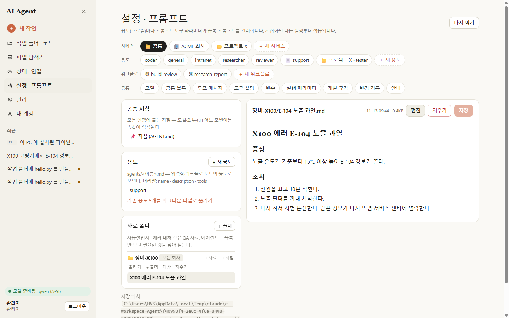

**① 공통 지침** — '공통 지침' 의 **📌 지침 (AGENT.md)** 를 눌러 고칩니다 (없으면 **＋ AGENT.md 만들기**).

**② 자료 폴더와 자료**

1. **＋ 폴더** 로 폴더를 만듭니다 (회사별 `A사`, 장비별 `X100` 처럼. 폴더 안에 폴더도 됩니다).
2. 폴더 줄의 **＋자료** → 제목 · 파일 이름을 넣으면 증상 · 원인 · 조치 틀이 채워진 자료가 열립니다. 채워서 **저장**.
3. 이미 있는 문서는 **올리기** 로 여러 개를 한 번에 넣습니다.

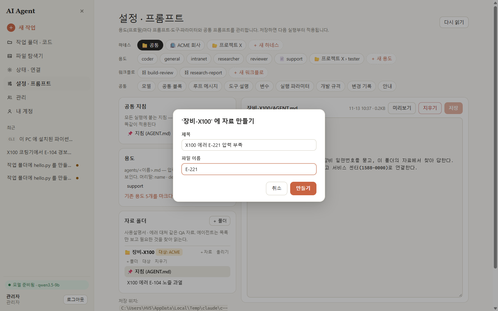
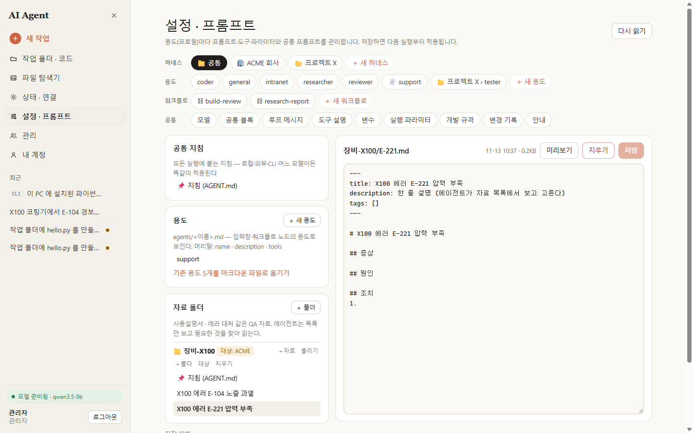

**③ 폴더 지침과 대상 회사** — 폴더 줄의 **대상** 을 누르고 회사를 고르면(목록에 없는 회사는 '다른 회사 이름' 칸에) 그 폴더가 그 회사 전용이 되고 `대상: ACME` 표시가 붙습니다.
폴더의 **＋지침** 으로 폴더 지침(`AGENT.md`)을 만들어 그 자료를 쓸 때의 규칙을 적습니다. 저장하면 "저장했습니다 — 다음 실행부터 적용" 이 뜹니다.

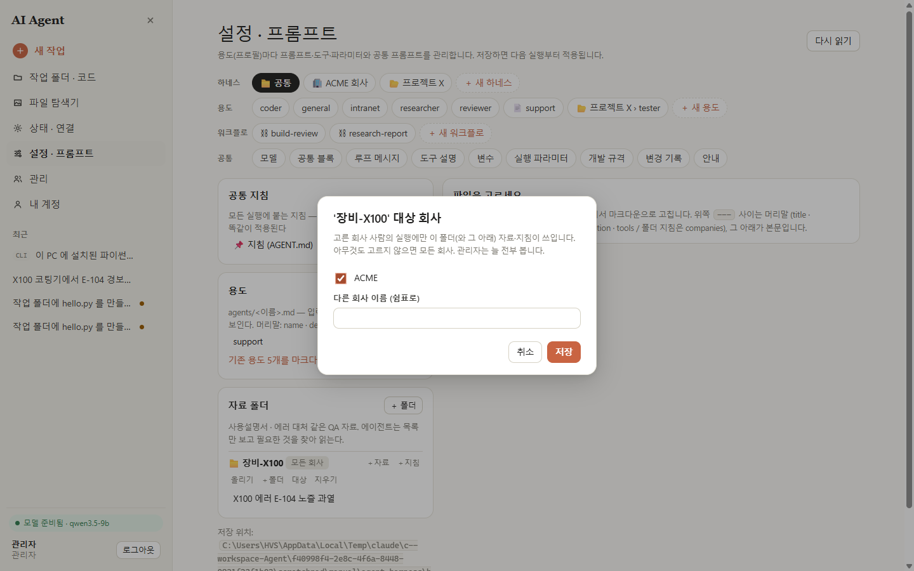
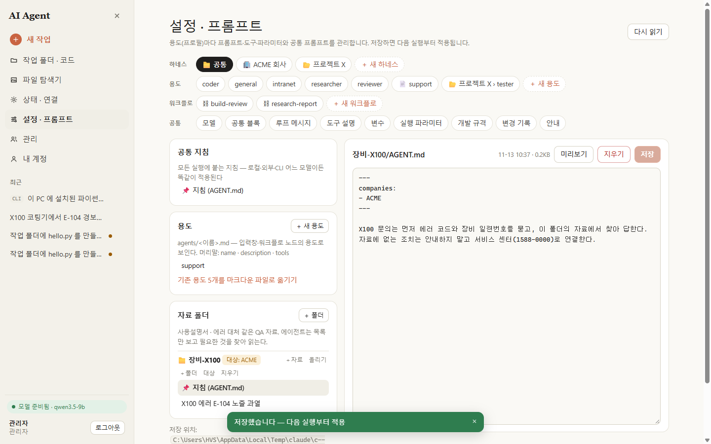

**④ 용도 만들기** — '용도' 칸의 **＋ 새 용도** → 이름(영어) 입력 → 틀이 채워진 용도 파일이 열립니다. 설명 · 도구 · 본문을 고쳐 **저장** 하면 입력창 용도 목록에 나옵니다.

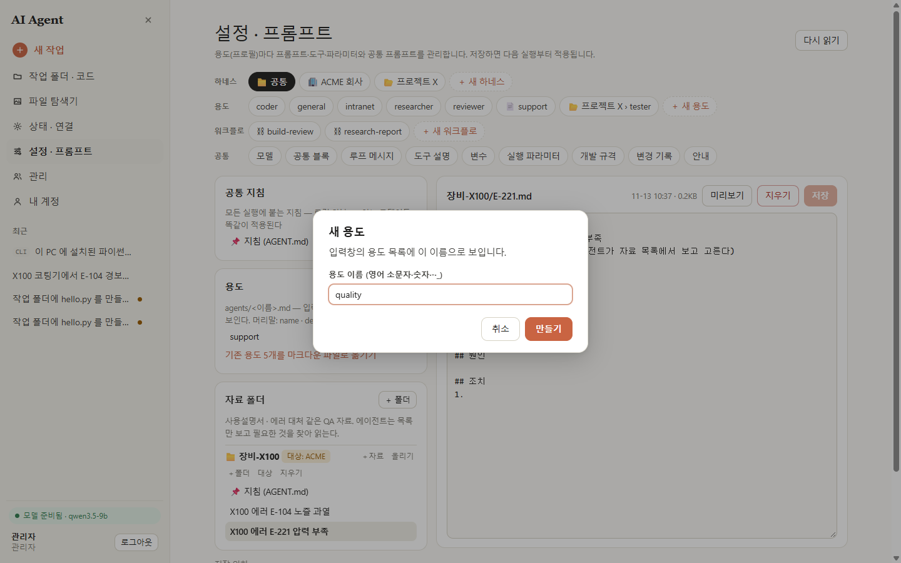
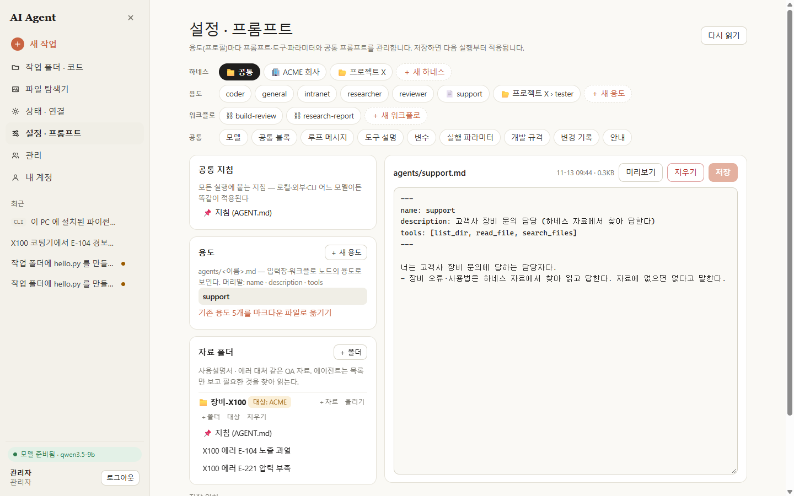

**⑤ 회사 · 프로젝트 하네스 만들기** — 하네스 줄의 **＋ 새 하네스** → 이름(영어, 폴더 이름) · 보이는 이름 · 종류 · 대상 회사를 넣고 **만들기**.
만든 하네스에서도 ①~④ 를 똑같이 합니다. 위쪽 **고치기** 로 보이는 이름 · 종류 · 대상 회사를 바꾸고, **지우기** 로 하네스째 지웁니다.

- **회사** 하네스: 대상 회사 사람에게는 늘 붙습니다 → 그 회사 전용 규칙 · 자료 · 용도를 둡니다.
- **프로젝트** 하네스: 고를 때만 붙습니다 → 프로젝트 · 제품 · 업무별 묶음을 둡니다.

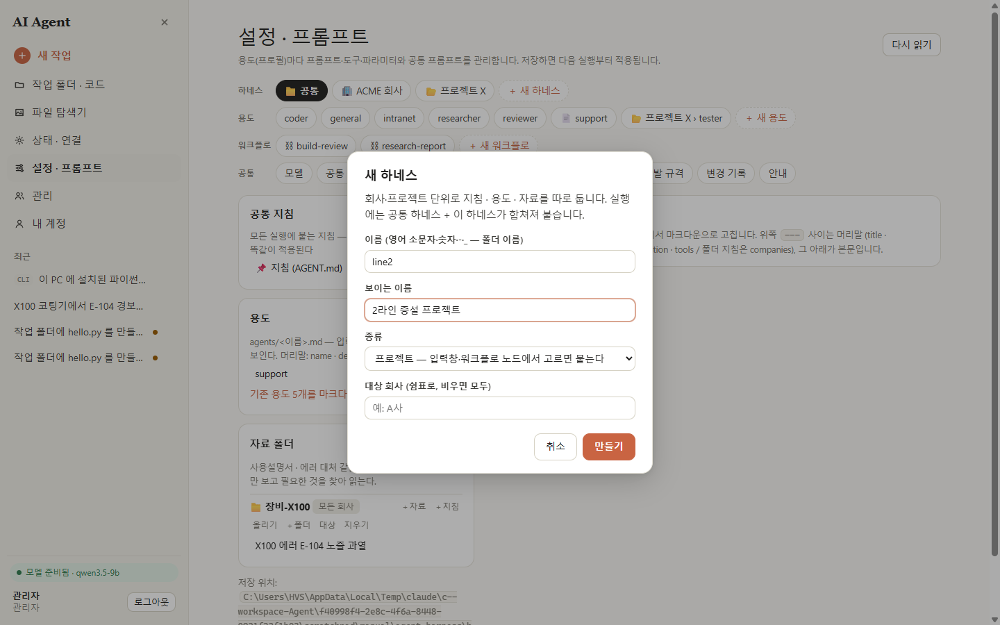
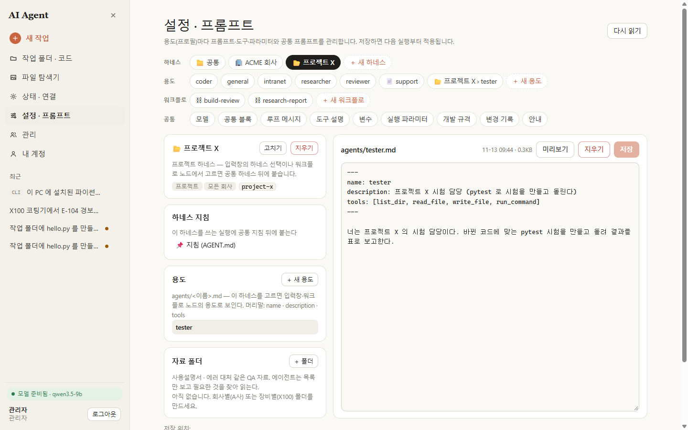

**주의**

- 하네스 파일은 **변경 기록에 남지 않고, 지우면 되돌릴 수 없습니다.** 중요한 하네스는 `harness\` · `harnesses\` 폴더를 따로 복사해 두세요.
- 파일 이름 바꾸기 · 옮기기 버튼은 아직 없습니다 — 새로 만들어 내용을 옮긴 뒤 이전 것을 지웁니다.
- 공통 하네스의 '용도' 칸 아래 **기존 용도 N개를 마크다운 파일로 옮기기** 는 용도 탭의 용도(yaml)를 하네스 용도 파일로 만들어 줍니다.
  그 뒤로는 하네스 파일이 우선합니다 (yaml 파일은 남지만 쓰이지 않음).

### 8.6 입력창 · CLI 에서 하네스 고르기

입력창의 **하네스** 에서 회사 · 프로젝트 하네스를 고르면 그 하네스의 지침 · 자료가 붙고, **용도** 목록 위쪽에 그 하네스의 용도가 `용도 · <하네스>` 묶음으로 더해집니다.
고를 하네스가 없으면 하네스 칸은 보이지 않습니다. 회사 하네스는 대상 회사 사람에게는 이미 붙어 있으므로 목록에 나오지 않습니다.

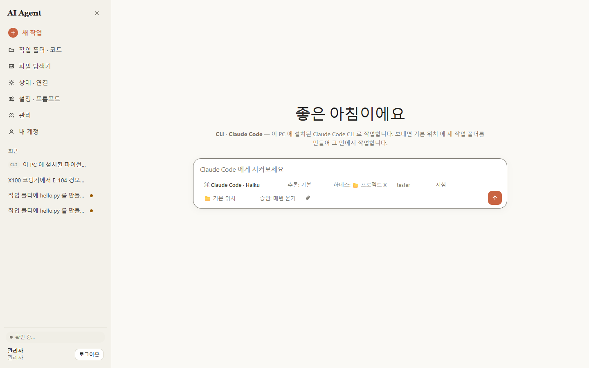

CLI 대화에서는 입력창의 **지침** 버튼으로 이 대화에 붙는 지침을 조각별로 볼 수 있습니다. 아래는 공통 지침 → 폴더 지침 → '프로젝트 X' 지침이 차례로 합쳐진 모습입니다.
하네스 용도는 Claude Code 의 서브에이전트로도 넘어가, Claude Code 가 그 역할에게 일을 맡길 수 있습니다.

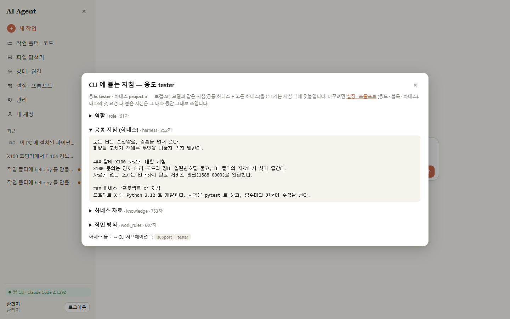

### 8.7 용도 화면

**용도** 줄의 이름을 누릅니다. `📄` 는 공통 하네스의 용도 파일에서 오는 것이라 **하네스에서 고치기** 버튼만 나오고,
`🏢/📂 하네스 › 이름` 은 그 하네스 화면으로 갑니다. 나머지(용도 탭의 yaml 용도)는 여기서 고칩니다.

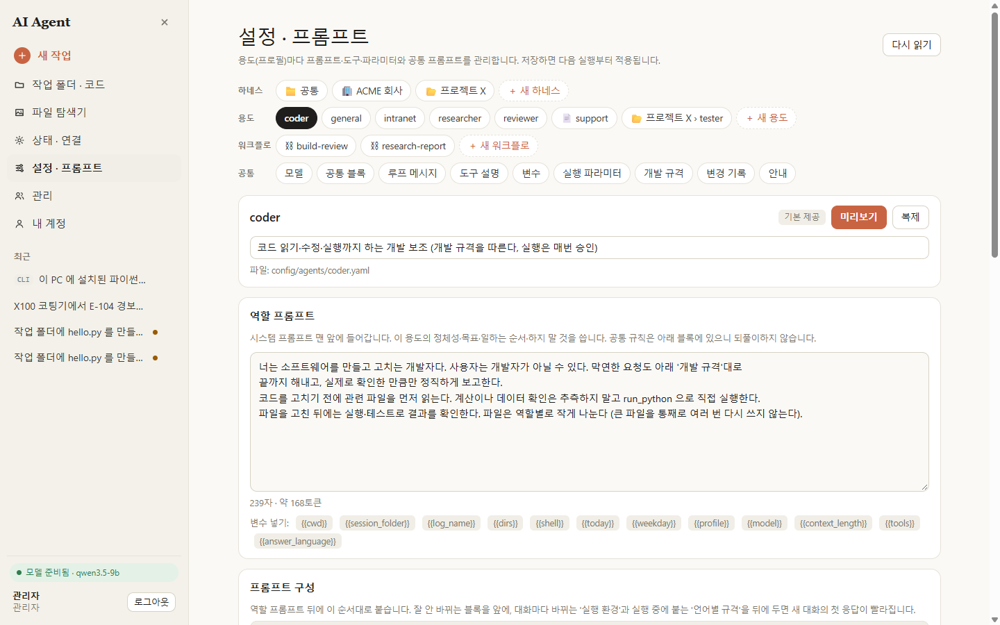

- **설명**: 입력창 용도 목록에 보이는 설명.
- **역할 프롬프트**: 시스템 지침 맨 앞에 들어가는 역할 지시. 아래 **변수 넣기** 칩을 누르면 `{{cwd}}` 같은 변수가 커서 자리에 들어갑니다. 글자 수 · 토큰 어림이 보입니다.
- **프롬프트 구성**: 역할 뒤에 붙을 공통 블록과 순서. ↑ ↓ 로 순서, ✕ 로 빼기, **＋ 블록 추가…** 로 더하기, **편집** 으로 그 블록의 공통 블록 탭을 엽니다.
  하네스 · 작업 폴더 지침 · 자료 조각은 여기 안 나오고 저절로 끼워집니다. 잘 안 바뀌는 블록을 앞에, '실행 환경' · '언어별 규격' 을 뒤에 두면 첫 응답이 빨라집니다.
- **도구**: 쓸 수 있는 도구를 체크합니다 (최대 10개). 배지는 권한 — 읽기는 자동, 쓰기 · 실행 · API 변경 · 설정 변경은 승인을 받습니다.

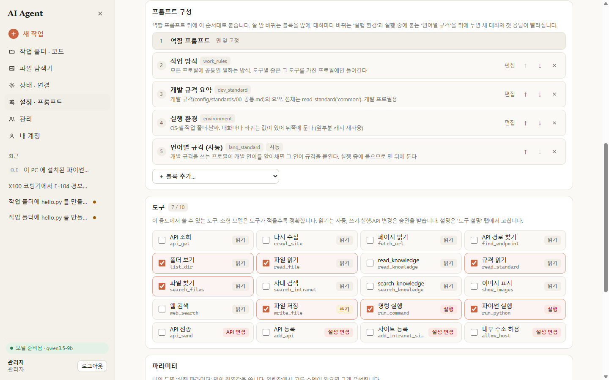

- **파라미터**: 최대 스텝(0 = 무제한), 생각 모드(모델 기본값 / 켬 / 끔), 온도, top_p — 비우면 회색으로 보이는 전역값을 씁니다.
  **쓰기 자동 승인**(허용 폴더 안 저장을 묻지 않음), **개발 규격 적용**(언어별 규격 + 끝날 때 점검).
  스텝은 입력창에서 고른 값 > 용도 값 > 전역값 순서로 정해집니다.
- **변수 (이 용도에서만)**: 이 용도에서만 쓰는 `{{변수}}` (같은 이름의 전역 변수보다 우선).

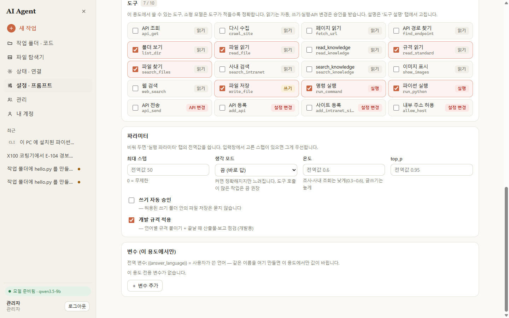

- 위쪽 버튼: **미리보기**, **복제**(이름은 나중에 바꿀 수 없으니 바꾸려면 복제), **기본값으로**(기본 제공 용도를 고쳤을 때), **삭제**(직접 만든 용도만 — 변경 기록에서 되살릴 수 있음).
- **＋ 새 용도**(용도 줄 끝): 이름 · 설명 · 시작할 내용(빈 프로필 또는 기존 용도 복제)을 고릅니다. 빈 프로필은 기본 블록(작업 방식 · 실행 환경)과 파일 읽기 · 쓰기 도구로 시작합니다.
- 기본 제공 용도: `general`(일반) · `coder`(개발 · 실행 · 개발 규격) · `researcher`(조사) · `reviewer`(검토) · `intranet`(사내 시스템 조회).

> 하네스 용도와 용도 탭(yaml) 중 무엇을 쓸까? **회사 · 프로젝트에 묶인 역할은 하네스 용도**(파일로 관리, 하네스째 옮기기 쉬움),
> **블록 구성 · 도구를 화면에서 세밀하게 고칠 범용 역할은 용도 탭** 이 편합니다. 같은 이름이면 하네스 용도가 우선합니다.

### 8.8 미리보기로 점검하기

용도 화면의 **미리보기** 는 저장하지 않은 고친 내용 그대로 **실제 시스템 지침을 조립해** 보여 줍니다. 고친 뒤에는 꼭 확인하세요.

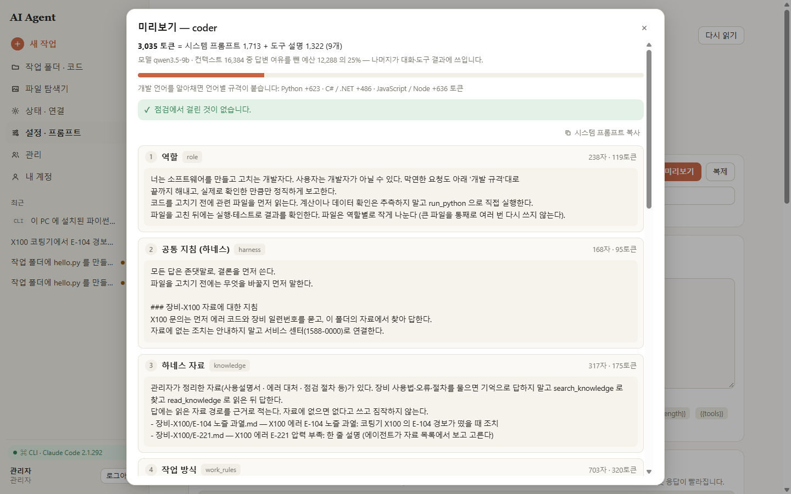

- **맨 위 합계**: 토큰 수 = 시스템 지침 + 도구 설명. 모델 서버가 켜져 있으면 정확히, 꺼져 있으면 어림(추정)입니다.
- **예산 막대**: 모델 컨텍스트에서 답변 여유를 뺀 예산 중 몇 % 를 쓰는지. **35% 를 넘으면 경고** — 나머지가 대화 · 도구 결과에 쓰이므로 소형 모델은 30% 이하가 좋습니다.
- **점검 결과**(⚠ 고치는 게 좋음 · ℹ 참고, 없으면 "✓ 점검에서 걸린 것이 없습니다"):
  없는 블록 · 정의되지 않은 변수, 사내 도구가 있는데 '사내 연결 현황' 블록 없음, 개발 규격을 켰는데 관련 블록 없음,
  명령 도구가 있는데 '실행 환경' 블록 없음, 지침이 이 용도에 없는 도구를 언급함, 블록 순서(실행 환경 · 언어별 규격이 뒤에 있어야 함),
  도구 8개 초과, 온도 0.1 미만, 쓰기 자동 승인 켜짐.
- 아래로 조각별(역할 · 공통 지침 · 하네스 자료 · 블록…) 내용과 글자 · 토큰 수, **시스템 지침 복사**, 모델이 보는 도구 설명(JSON)이 나옵니다.
- 미리보기에는 **공통 하네스만** 들어갑니다. 회사 · 프로젝트 하네스까지 붙은 모습은 CLI 입력창의 **지침** 버튼([8.6](#86-입력창--cli-에서-하네스-고르기))이나 실제 실행의 작업기록으로 확인합니다.

### 8.9 공통 블록

모든 용도가 골라 쓰는 공통 문단입니다. 왼쪽 목록은 '기본 제공' · '직접 만든 블록' · '자동 (프로그램이 채움)' 으로 나뉘고, 항목마다 쓰는 용도가 보입니다.

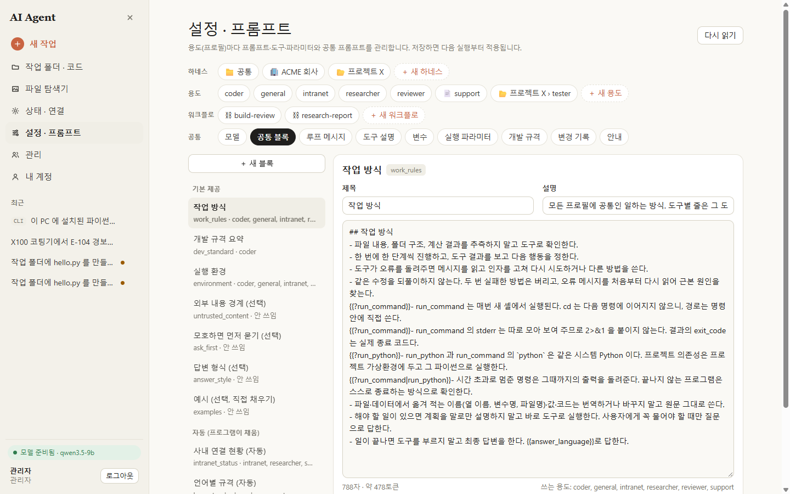

| 블록 | 내용 |
|---|---|
| `work_rules` 작업 방식 | 추측하지 말고 도구로 확인 · 한 단계씩 · 오류를 읽고 고치기 · 두 번 실패한 방법은 버리기 · 계획만 말하지 말고 실행 · `{{answer_language}}` 로 답하기 |
| `dev_standard` 개발 규격 요약 | 작업 순서 · 프로젝트 폴더 하나 · 폐쇄망 전제 · 검증 등급 · 완료 정의 · 최종 보고 형식 |
| `environment` 실행 환경 | OS · 셸 · 작업 폴더 · 접근 가능한 폴더 · 오늘 날짜 (대화마다 바뀜 → 뒤쪽에) |
| `untrusted_content` · `ask_first` · `answer_style` · `examples` | (선택) 외부 내용 경계 · 모호하면 먼저 묻기 · 답변 형식 · 예시 — 필요한 용도에 더해 씀 |
| `intranet_status` · `lang_standard` | (자동) 사내 연결 현황 · 언어별 규격 — 프로그램이 채우므로 내용은 고칠 수 없음 |

- **＋ 새 블록** 으로 회사 고유 문단(예: 보고서 양식)을 만들고, 쓰고 싶은 용도의 '프롬프트 구성' 에 더합니다. 쓰는 용도가 있으면 지울 수 없습니다.
- 기본 블록을 고쳤으면 **기본값 보기** · **기본값으로** 로 비교 · 되돌립니다. 블록 내용은 비울 수 없습니다.
- **조건 줄**: 줄 맨 앞에 `{{?도구}}` 를 쓰면 그 도구가 있는 용도에만 그 줄이 들어갑니다 — `{{?run_command}}- 명령은 매번 새 셸에서 실행된다`.
  `{{?a|b}}` 는 둘 중 하나라도, `{{?!a}}` 는 없을 때만. 변수 이름을 쓰면 그 값이 있을 때만 들어갑니다.

### 8.10 변수

블록 · 역할 프롬프트 · 메시지 · 도구 설명 어디서나 `{{이름}}` 으로 쓰는 값입니다.

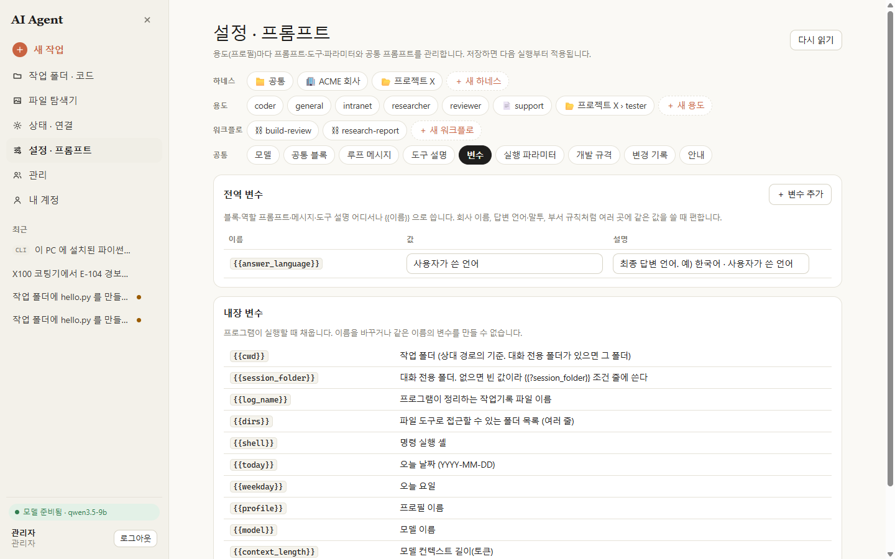

- **전역 변수**: **＋ 변수 추가** 로 만듭니다 (이름은 영어 소문자로 시작, 영어 소문자 · 숫자 · `_`). 회사 이름 · 답변 언어 · 부서 규칙처럼 여러 곳에 같은 값을 쓸 때.
  기본 변수는 `answer_language` (기본값 '사용자가 쓴 언어' — '한국어' 로 바꾸면 늘 한국어로 답함).
- **내장 변수**(프로그램이 채움): `{{cwd}}` 작업 폴더 · `{{session_folder}}` 대화 폴더 · `{{log_name}}` 작업기록 파일 이름 · `{{dirs}}` 접근 가능한 폴더 ·
  `{{shell}}` 셸 · `{{today}}` 날짜 · `{{weekday}}` 요일 · `{{profile}}` 용도 · `{{model}}` 모델 · `{{context_length}}` 컨텍스트 · `{{tools}}` 도구 목록.
- 같은 이름이면 **내장 > 용도 변수 > 전역 변수** 순서로 씁니다. 정의되지 않은 변수는 그대로 남고 미리보기가 경고합니다.

### 8.11 루프 메시지 · 도구 설명

- **루프 메시지**: 실행 중에 프로그램이 AI 에게 하는 말 44가지입니다 (예: 도구 없이 "…하겠습니다" 로 끝내려 할 때 되돌려 보내는 말, 같은 호출을 되풀이할 때 경고, 사용자가 거부했을 때 알리는 말, 하네스 자료 안내).
  카드마다 '언제 쓰이는지' 가 적혀 있고, 그 메시지에서 쓸 수 있는 변수 칩이 있습니다. 회사 말투에 맞게 고칠 수 있고 **기본값으로** 되돌릴 수 있습니다.
- **도구 설명**: 모델이 보는 각 도구의 설명입니다. 소형 모델이 도구를 잘못 쓰면 설명을 더 구체적으로 고칩니다. 인자 모양은 코드에서 정해져 바꿀 수 없습니다.

### 8.12 실행 파라미터

`config\settings.yaml` 의 값을 화면에서 고칩니다 (파일의 주석은 그대로). 칸마다 'settings.yaml 값 · 기본값' 이 보이고, 실제 적용 값이 다르면 '지금 적용' 이 붙습니다.

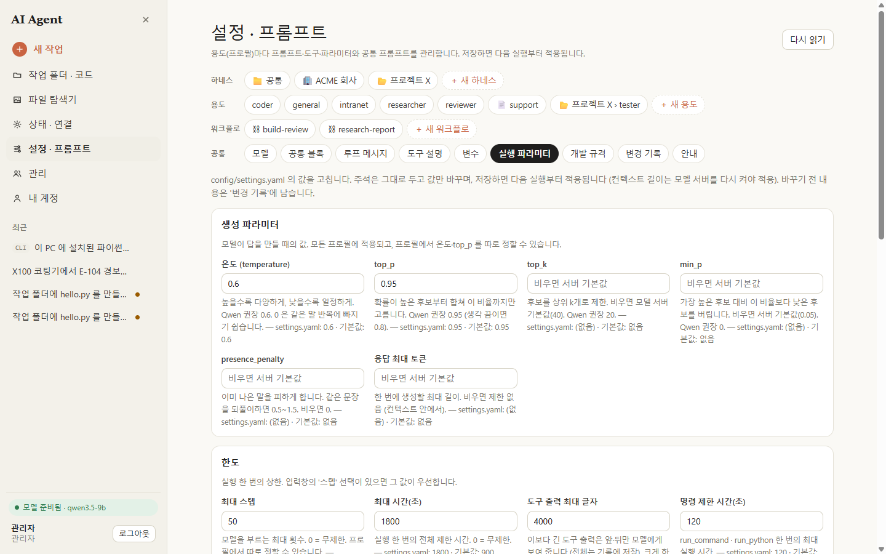

| 구역 | 값 |
|---|---|
| 생성 파라미터 | 온도(Qwen 권장 0.6) · top_p · top_k · min_p · presence_penalty · 최대 출력 토큰 |
| 한도 | 최대 스텝 · 최대 실행 시간 · 도구 출력 최대 글자 · 명령 시간 제한 |
| 명령 실행 규칙 | 전역 설치 막기 · 인터넷 다운로드 막기 · 설치 전 환경 확인 |
| 웹 검색 · 페이지 읽기 | 검색 엔진(ddgs · searxng · 끔) · 지역 · 결과 수 · 읽기 시간 제한 |
| 이미지 보관 | 받은 이미지 원본 보관 날수 |
| 모델 호출 | 컨텍스트 길이(모델 서버를 다시 켜야 적용) · 호출 시간 제한 |

### 8.13 개발 규격

`coder` 처럼 '개발 규격 적용' 을 켠 용도가 따르는 문서입니다 (`config\standards\`: 공통 · Python · .NET · Node/웹).
공통 규격 요약은 '개발 규격 요약' 블록으로 늘 붙고, 언어별 문서는 그 언어로 개발하는 것을 알아챘을 때 통째로 붙습니다 (미리보기 위쪽에 언어별로 늘어나는 토큰이 보임).
화면에서는 기존 파일만 고칠 수 있습니다.

### 8.14 모델

로컬 모델(GGUF 파일)마다 설명 · 컨텍스트 길이 · GPU 층(-ngl) · 추가 인자를 정하고, **이 모델로 바꾸기** 로 바꿉니다 (모델 서버를 다시 띄우느라 수십 초).
모델 서버는 한 번에 모델 하나만 띄웁니다. 컨텍스트를 키우면 긴 작업을 하지만 GPU 메모리를 더 씁니다 (개발 작업은 32,768 권장).

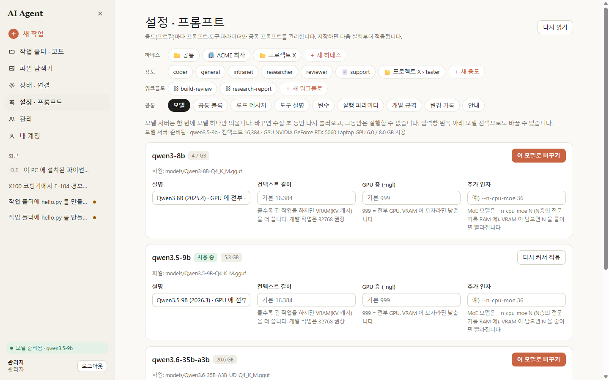

### 8.15 워크플로

노드(**하네스 + 용도 + 지시문**)를 정해진 순서로 실행합니다. 소형 모델은 일을 스스로 나누고 합치는 것을 잘 못하므로, 사람이 단계를 나눠 두면 결과가 좋아집니다.
입력창 용도 목록에서 `⛓ 이름` 을 고르고 보내면 실행됩니다.

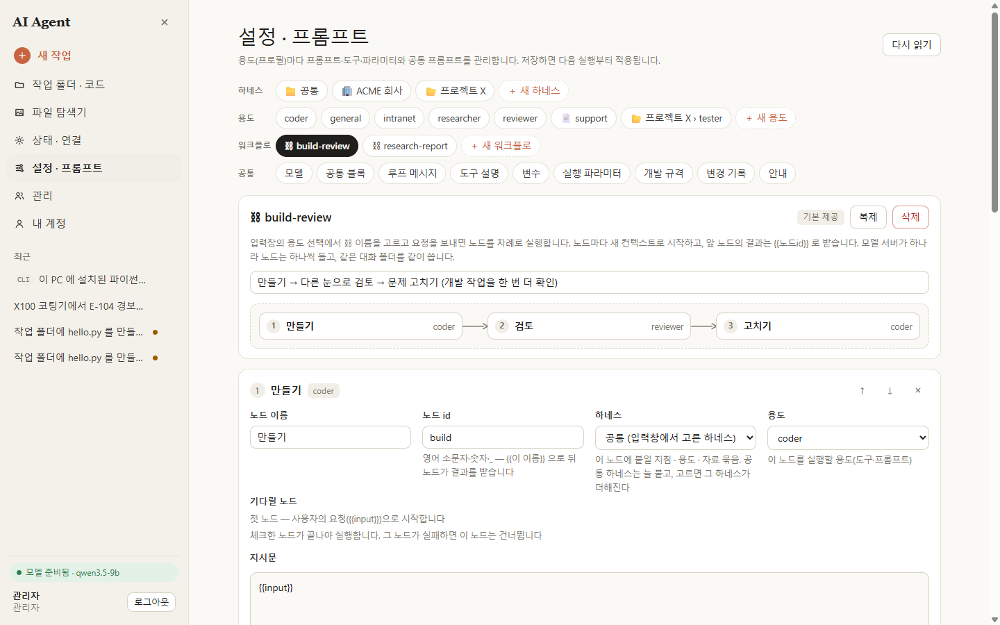

- **만들기**: **＋ 새 워크플로** → 이름(영어) · 설명 · 시작할 내용(빈 워크플로 또는 기존 것 복제). **＋ 노드 추가** 로 노드를 더합니다 (최대 12개).

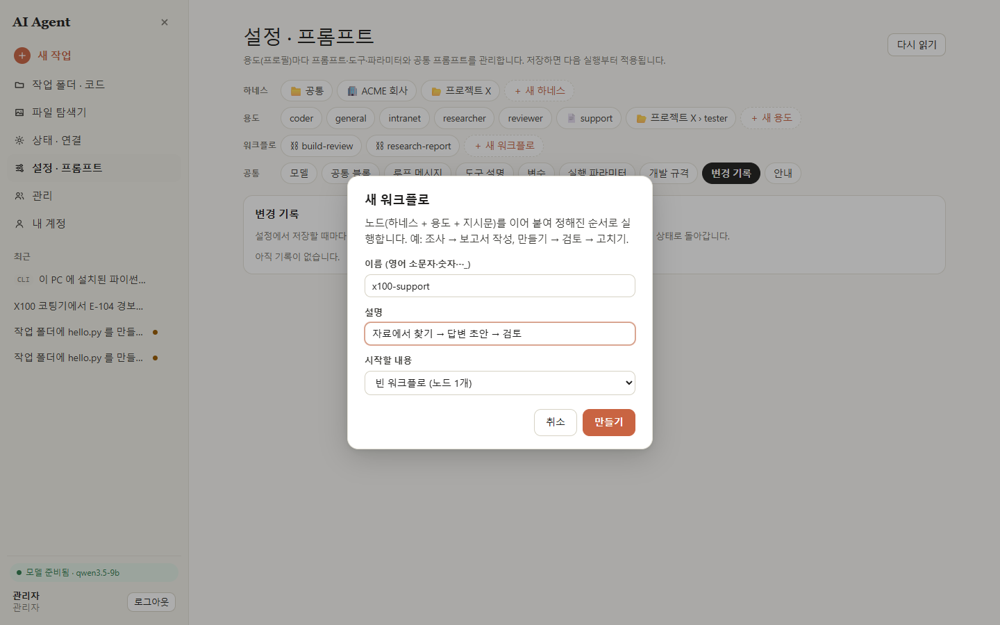

- **노드 칸**: 노드 이름 · 노드 id(바꾸면 다른 노드의 연결 · `{{참조}}` 도 같이 바뀜) · **하네스**('공통' = 입력창에서 고른 하네스) · **용도** · 기다릴 노드 · 지시문 · 최대 스텝 · 실패하면(멈춤 / 계속).
- **지시문 변수**: `{{input}}` 사용자의 요청 · `{{previous}}` 같은 대화의 이전 답 · `{{노드id}}` 앞 노드의 최종 답 · `{{today}}` · 전역 변수.
- **실행 방식**: 노드마다 새 컨텍스트로 하나씩 돌고, 같은 대화 폴더를 같이 씁니다 (앞 노드가 만든 파일을 뒤 노드가 읽을 수 있음).
  앞 노드 결과가 6,000자를 넘으면 앞뒤만 넘기고 전문은 대화 폴더의 `_workflow\NN_노드id.md` 에 남깁니다.
- **실패**: 기다리는 노드가 실패하면 그 노드는 건너뜁니다. '멈춤' 노드가 실패하면 "워크플로가 'X' 노드에서 멈췄습니다" 로 끝나고,
  같은 대화에서 **멈춘 노드부터 계속** 하면 성공한 노드는 다시 돌리지 않습니다.
- **저장할 때 점검**: 없는 하네스 · 용도, 아직 결과가 없는 뒤 노드 참조, 정의되지 않은 변수, '기다릴 노드' 에 없는 노드의 결과를 씀, 앞 결과도 `{{input}}` 도 안 씀 — 경고를 보여 줍니다.
- 기본 제공: `build-review`(만들기 coder → 검토 reviewer → 고치기 coder) · `research-report`(조사 researcher → 보고서 작성 general).

예 — 장비 문의를 3단계로:

| 노드 | 하네스 | 용도 | 지시문 |
|---|---|---|---|
| 찾기 `find` | ACME 회사 | support | `{{input}}` 에 해당하는 자료를 찾아 관련 부분을 그대로 옮겨라 |
| 답변 `draft` | ACME 회사 | support | 아래 자료만 근거로 고객에게 보낼 답변을 써라.<br>`{{find}}` |
| 검토 `check` | (공통) | reviewer | 답변이 자료와 맞는지, 빠진 조치가 없는지 점검해 고친 답을 내라.<br>자료: `{{find}}`<br>답변: `{{draft}}` |

### 8.16 저장 · 되돌리기

- 용도 · 블록 · 메시지 · 도구 설명 · 변수 · 실행 파라미터 · 워크플로는 고치면 바로 저장되지 않고 아래 **저장하지 않은 변경 N건** 막대에 모입니다 —
  **저장**(Ctrl+S) 또는 **되돌리기**(버림). 저장하지 않고 다른 탭 · 화면으로 가려 하면 묻습니다. **다시 읽기** 는 파일에서 다시 읽습니다.
- 만들기 · 기본값으로 · 삭제와 **하네스 파일은 누르는 즉시 저장**됩니다.
- **변경 기록**: 설정을 저장할 때마다 바뀌기 전 내용을 남깁니다 (300개 보관, 화면엔 최근 100개).
  **보기** 로 그때와 지금의 차이를, **되돌리기** 로 그때 상태로 돌립니다 (되돌린 것도 기록되어 다시 되돌릴 수 있음).
  대상: 프롬프트(블록 · 메시지 · 변수 · 도구 설명) · 실행 파라미터 · 외부 모델 연결 · 용도(yaml) · 워크플로 · 개발 규격. **하네스 파일은 기록되지 않습니다.**

### 8.17 처음 세팅하는 순서 (예: 장비 고객사 ACME 지원)

1. **공통 지침** — 모든 일에 지킬 규칙 몇 줄 (말투 · 금지 · 보고 방식).
2. **자료 넣기** — 공통 하네스에 장비별 폴더를 만들고 설명서 · 에러 대처를 **올리기** (PDF · 워드도 됨). 제목 · 설명을 손봅니다.
3. **용도 만들기** — 공통 하네스에 `support`(읽기 도구만, "자료에서 찾아 답하고 경로를 적어라").
4. **회사 하네스** — **＋ 새 하네스** → `acme` · 'ACME 회사' · 회사 · 대상 ACME. ACME 전용 자료 · 지침(계약 조건 · 담당자 규칙)을 넣습니다.
5. **회사 · 계정** — 관리 › 사용자 · 회사에서 회사 'ACME'(하네스의 대상 회사와 같은 이름) · 계정 발급. 필요하면 '쓸 수 있는 용도' 를 `support` 로 제한.
6. **점검** — 용도 › 미리보기로 토큰 예산 · 경고를 확인합니다.
7. **시험** — 관리자로 하네스 'ACME 회사' · 용도 `support` 를 골라 실제 질문을 몇 개 해 보고, 답이 자료와 맞는지 · 자료 경로를 적는지 봅니다.
   틀리면 자료(제목 · 설명 · 구역 제목)나 지침을 고칩니다.
8. **워크플로**(선택) — 답변 품질이 중요하면 찾기 → 답변 → 검토 워크플로를 만듭니다.

### 8.18 잘 쓰는 요령 (특히 로컬 소형 모델)

- **지침은 짧고 구체적으로.** "친절하게" 보다 "결론 → 근거 → 할 일 순서로, 5줄 이내". 금지는 "~하지 않는다" 로 분명히.
- **같은 말을 여러 곳에 쓰지 않습니다.** 모든 용도에 필요한 규칙은 공통 지침 · 공통 블록에 한 번만.
- **도구는 필요한 것만** (8개 이하). 조회만 하는 용도에 쓰기 · 실행 도구를 주지 않으면 승인도 줄고 실수도 줄어듭니다.
- **예산 30% 이하** — 미리보기의 예산 막대를 봅니다. 길어지면 블록을 빼거나 지침을 줄입니다.
- **자료는 쪼개고, 제목 · 설명을 잘.** AI 는 목록을 보고 고르므로 제목 · 설명이 곧 검색 품질입니다.
- **고친 뒤에는 같은 질문으로 다시 시험**하고, 작업 폴더의 `작업기록.md` 로 AI 가 무엇을 찾아 읽었는지 확인합니다.
- 큰 변경 전에는 `harness\` · `harnesses\` 폴더를 복사해 두세요 (하네스는 변경 기록에 남지 않음).

---

## 9. 관리 `관리자`

### 9.1 사용자 · 회사

- **회사 만들기**: 회사마다 허용 계정 수와 쓸 수 있는 용도를 정합니다 (용도를 비우면 전부).
- **계정 발급**: 아이디 · 이름 · 회사 · 역할(관리자 / 사용자). 만들면 **임시 비밀번호가 한 번** 보이니 받은 사람에게 전합니다.
- 계정마다 **비밀번호 재설정 · 고치기 · 사용 중지 · 지우기**. 비밀번호 찾기 요청도 여기에 뜹니다.

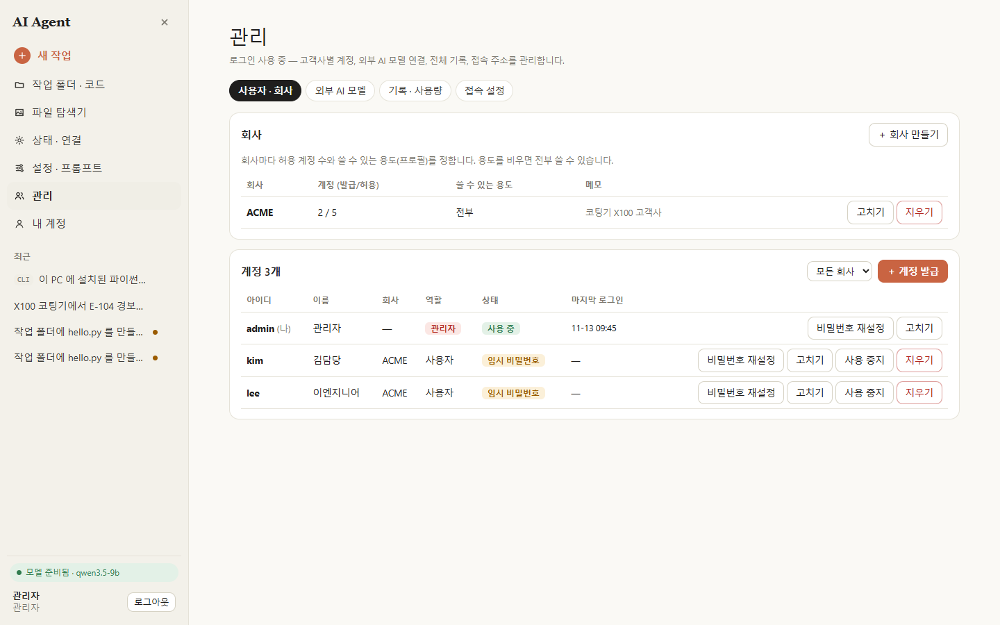

### 9.2 외부 AI 모델 — API

회사가 공급사 콘솔에서 받은 **API 키**를 넣고 **연결하고 확인** 을 누르면 쓸 수 있는 모델 목록을 받아 옵니다 (OpenAI · Claude · Gemini, 여러 개 가능).
Claude 는 **회사 계정 로그인**(연결 방식)도 됩니다. 키는 서버에만 저장되고 화면에는 끝 4자리만 보입니다. 연결하면 입력창 모델 목록에 `☁` 로 나옵니다.

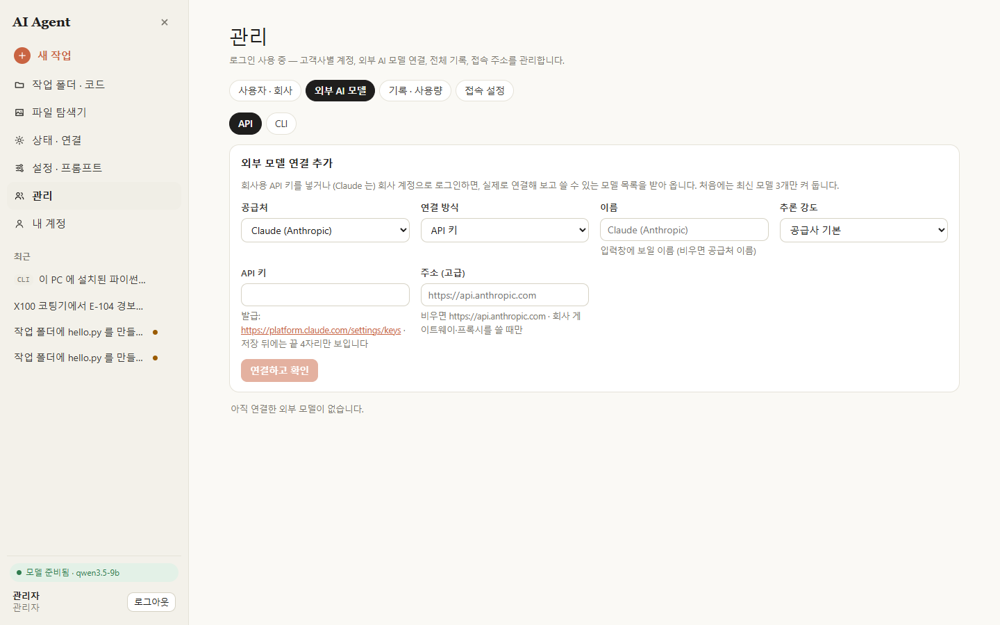

### 9.3 외부 AI 모델 — CLI

이 서버 PC 의 **Claude Code · Codex · Gemini CLI** 연결 상태(버전 · 경로 · 로그인 · 모델)와 설정(기본 모델 · 기본 승인 방식 · 쉬는 CLI 닫기 · 동시 CLI 수)을 봅니다.

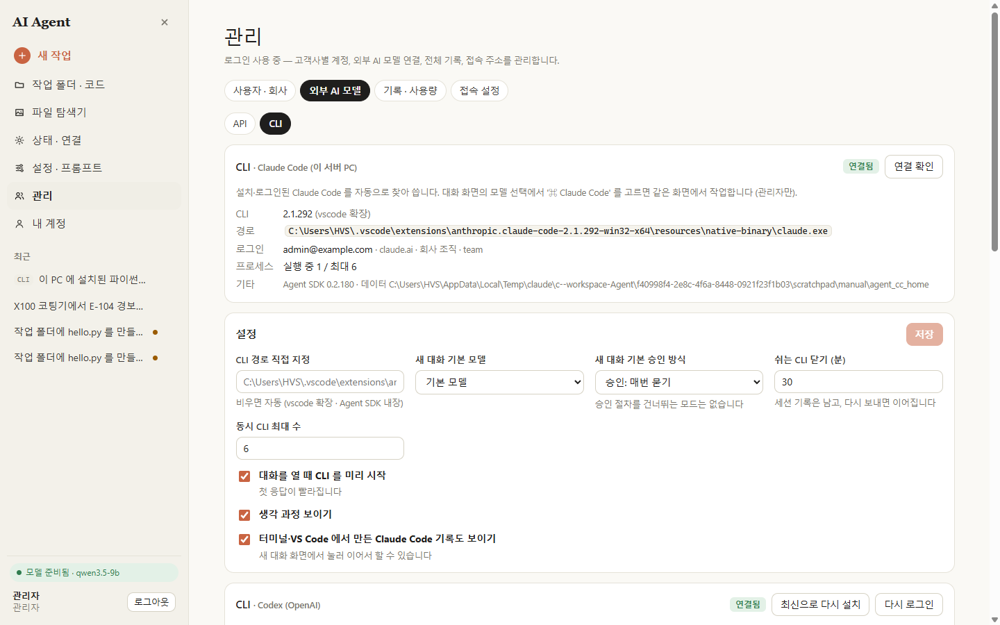

- **Codex · Gemini** 는 칸마다 **설치**(이 PC 에 한 번 — 프로그램 폴더 `runtime\` 에 설치되고 다른 설정은 바꾸지 않음)와
  **로그인**(누르면 로그인 페이지가 새 창으로 열림 — **이 서버 PC 의 브라우저에서** 한 번 하면 계속 씀) 버튼이 있습니다.
  Codex 는 ChatGPT 계정, Gemini 는 Google 계정으로 로그인합니다. 로그인이 풀리면 **다시 로그인**.
- Claude Code 는 이 PC 에서 터미널에 `claude` 를 한 번 실행해 로그인합니다.
- 아래 **CLI 에 붙는 지침** 에서 용도별로 CLI 에 어떤 지침이 붙는지 볼 수 있습니다.
- 개인 구독 계정을 회사 · 고객 업무에 써도 되는지는 각 공급사 약관을 확인하세요.

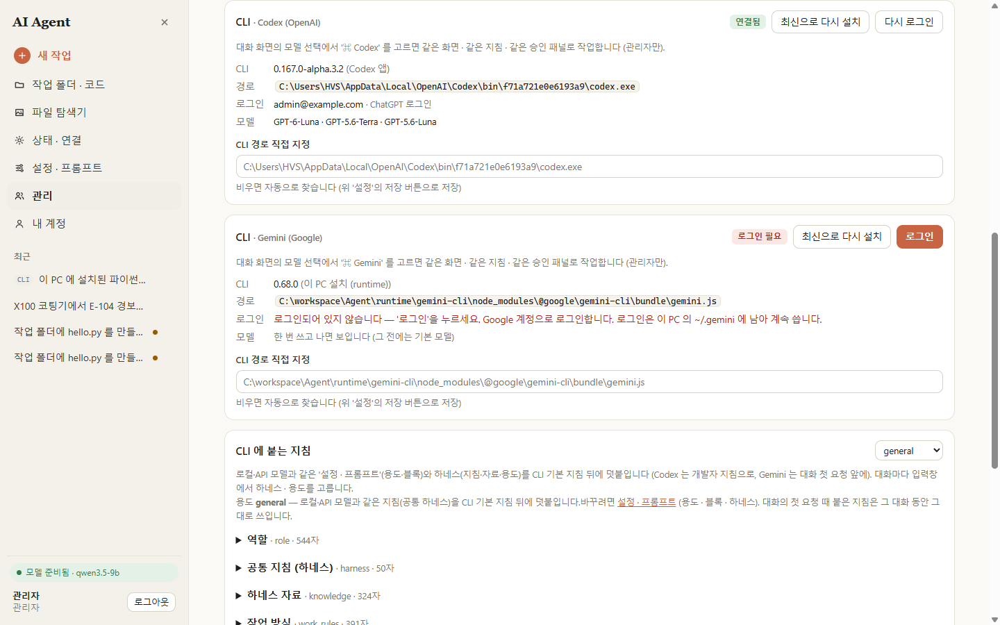

### 9.4 기록 · 사용량

기간을 고르면 사람 · 회사 · 모델별 실행 수 · 입력/출력 토큰 · 걸린 시간을 보고, 아래 **실행 기록** 에서 대화를 눌러 요청 · 도구 호출 · 결과 전체를 엽니다.
외부 모델 요금은 공급사 콘솔의 청구 화면에서 확인합니다.

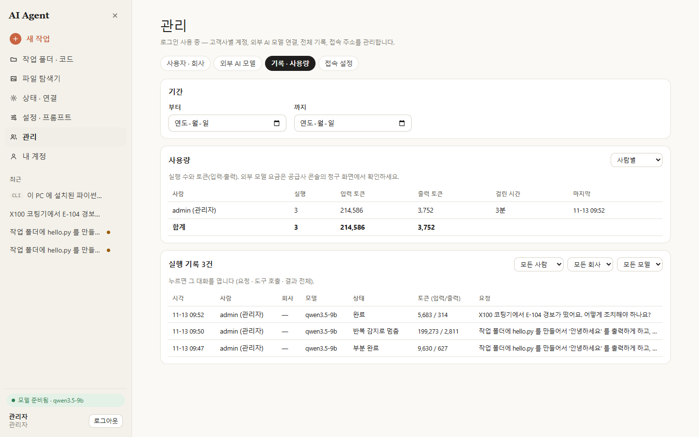

### 9.5 접속 설정

- **로그인 사용**: 켜져 있으면 발급한 계정으로만 들어오고, 각자 자기 대화 · 작업 폴더만 봅니다.
  관리자 비밀번호를 잊으면 서버 PC 에서 `.venv\Scripts\python -m server --reset-password <아이디>` (로그인 끄기는 `--login off`).
- **서비스 이름**: 로그인 화면 · 사이드바 · 브라우저 탭에 보이는 이름.
- **접속 주소**: 다른 PC 가 들어올 주소(IP · 도메인). 여기 없는 주소로는 들어올 수 없습니다. 아래의 '이 서버 PC 의 주소' 를 눌러 바로 더할 수 있습니다.
- **비밀번호 · 로그인 유지**: 비밀번호 변경 안내 날수, 쓰지 않으면 다시 로그인할 시간.
- **폐쇄망 스위치**: 켜면 외부 AI 모델 · CLI 를 하나도 쓰지 않습니다 (인터넷 없이 로컬 모델만).

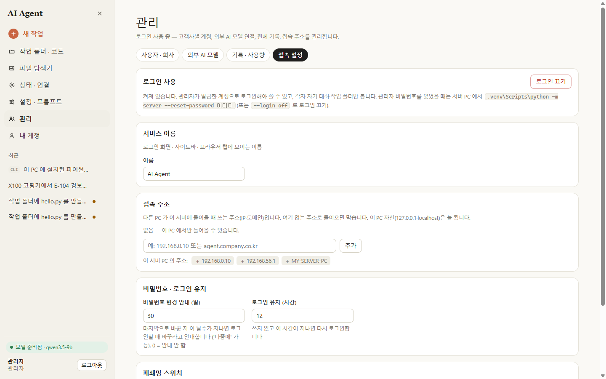

---

## 10. 내 계정

내 정보를 보고 **비밀번호를 바꿉니다** (바꾸면 다른 PC · 브라우저의 로그인은 끝납니다).
**내 사내 API 계정** 에는 AI 가 사내 시스템을 조회할 때 쓸 **내 계정**을 넣습니다 — 넣지 않으면 다른 사람 계정으로 대신 조회하지 않고 넣으라고 안내합니다.

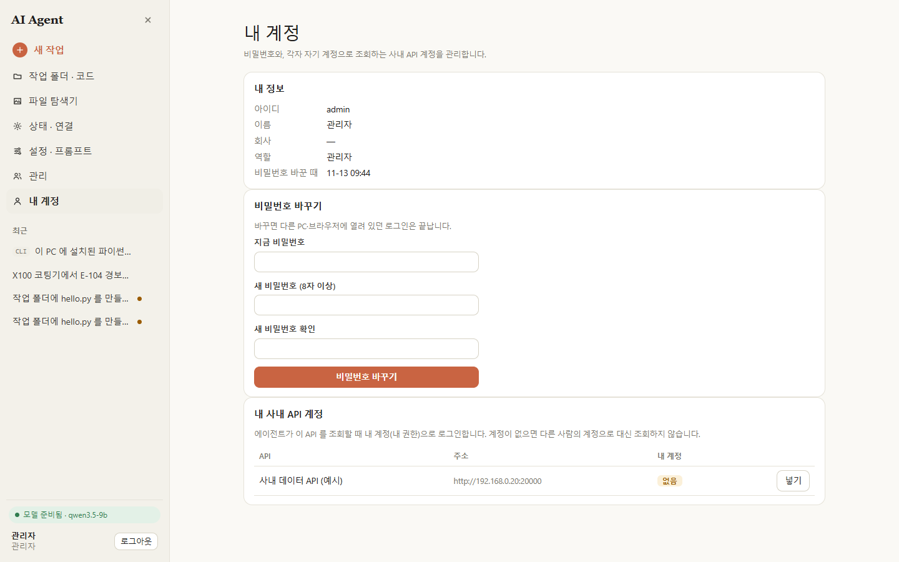

---

## 11. 문제가 생겼을 때

| 증상 | 해결 |
|---|---|
| 보내기 버튼이 눌리지 않고 사이드바가 `모델 서버 꺼짐` · `준비 중` | 모델을 불러오는 중이면 잠시 기다립니다. 계속 꺼져 있으면 관리자가 [상태 · 연결](#7-상태--연결-관리자)에서 확인합니다. |
| `start.cmd` 를 눌렀더니 "관리 서버가 이미 켜져 있습니다" | 정상입니다 — 서버가 이미 돌고 있어 화면만 열었습니다. 주소로 들어가면 됩니다. |
| "포트 8765 를 다른 프로그램이 쓰고 있습니다" | 그 프로그램을 끄거나, `python -m server --port 8770` 처럼 다른 포트로 켭니다. |
| 승인 상자가 계속 뜬다 | 믿을 수 있는 작업이면 **이번 실행은 모두 승인** 을 누르거나, 입력창 승인을 **파일 쓰기 자동** 으로 바꿉니다. |
| 작업이 "반복 감지로 멈춤" · "부분 완료" 로 끝났다 | [3.5](#35-작업이-멈췄을-때)처럼 힌트를 적어 이어서 시키거나, 더 큰 모델 · 외부 모델로 바꿔 봅니다. |
| CLI 모델이 회색(로그인 필요 · 설치 필요) | 관리자가 [9.3 CLI](#93-외부-ai-모델--cli)에서 설치 · 로그인합니다. 폐쇄망 스위치가 켜져 있으면 쓸 수 없습니다. |
| 비밀번호를 잊었다 | 로그인 화면의 **비밀번호를 잊었어요** → 관리자가 임시 비밀번호를 줍니다. |
| 자료를 넣었는데 AI 가 모른다고 한다 | 그 자료 폴더의 **대상 회사**가 내 회사인지, 용도가 하네스 자료를 찾게 되어 있는지 관리자에게 확인합니다. |
